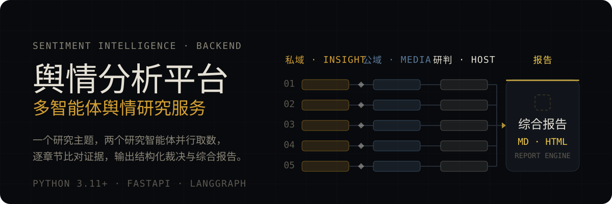
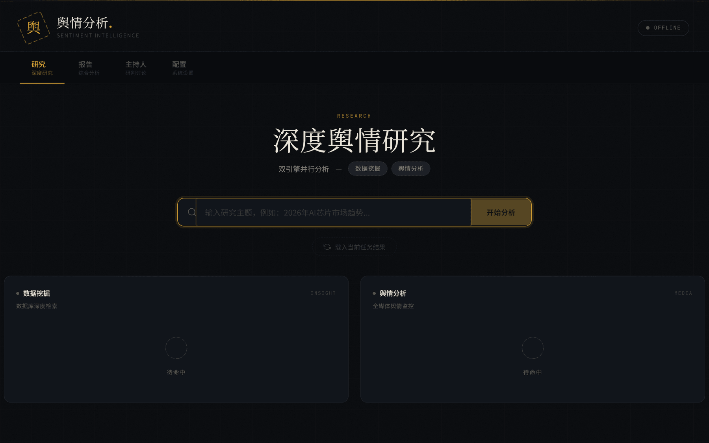
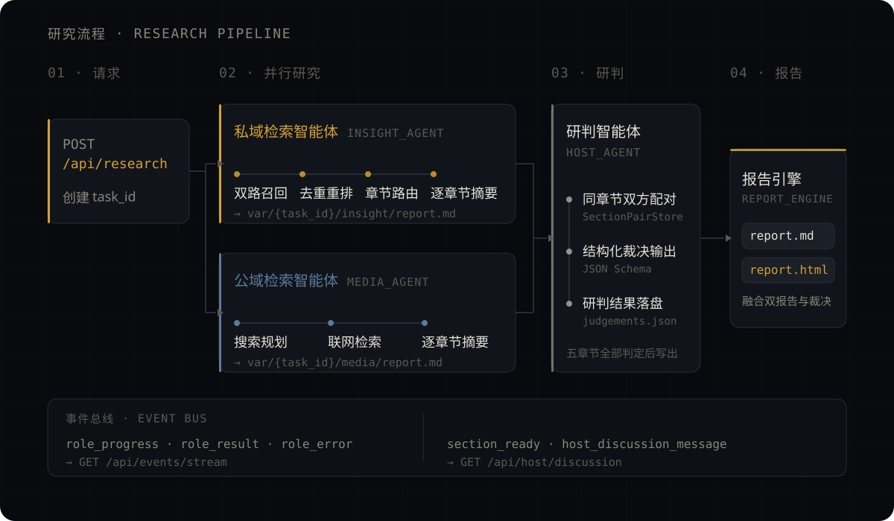
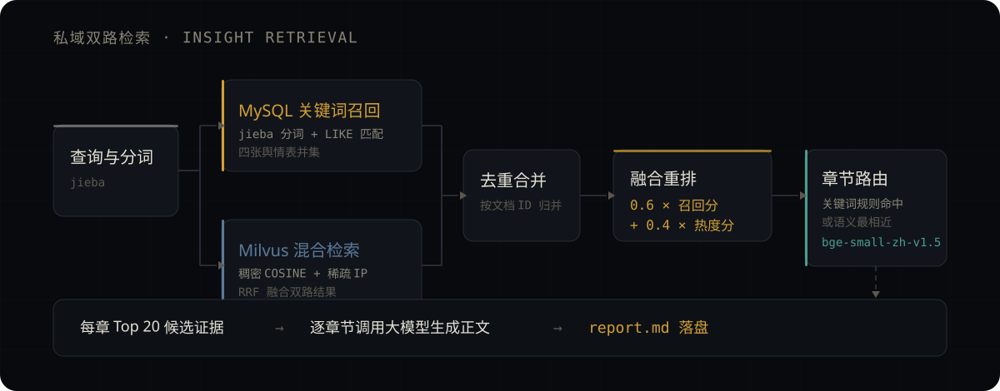

<p align="center">
  
</p>

围绕一个研究主题，**私域检索**与**公域检索**两个研究智能体并行取数，再按同一套固定章节各写一份报告；
**研判智能体**逐章节比对双方证据、输出结构化裁决，最后由**报告引擎**融合三方产物，产出一份 Markdown / HTML
综合舆情报告。研究过程通过 **SSE** 实时推送到前端。

> 单仓库包含两部分：`backend/`（本 README 所述的 FastAPI 服务）与 `frontend/`（配套 Web 控制台）。

<p align="center">
  
</p>

---

## 核心能力

- **多智能体协同研究**：私域（insight）与公域（media）两个研究智能体并行执行，互不阻塞。
- **固定五章节契约**：所有角色对齐同一套章节定义，最终报告结构稳定、可逐章节对比。
- **双路混合检索**：私域侧同时走 MySQL 关键词召回与 Milvus 向量召回，融合去重后统一重排。
- **实时研判**：Host 监听章节就绪事件，同一章节的双 Agent 输出一旦配齐即刻触发研判。
- **结构化裁决**：以 JSON Schema 约束研判输出，作为最终报告的结论依据。
- **实时进度**：SSE 推送角色进度、结果与错误，讨论区同步双方发言与裁决。
- **在线配置**：Web 端可直接读写 `.env` 中的白名单配置并热重载，无需重启进程。
- **报告交付**：综合报告同时产出 Markdown 与带样式 HTML，支持在线预览与下载。

---

## 系统架构

<p align="center">
  
</p>

### 四个智能体角色

每个角色拥有独立的模型配置（`{角色}_MODEL_PROVIDER` / `_BASE_URL` / `_API_KEY` / `_MODEL_NAME`），
由 `LLMClient.from_role()` 统一构造，互不干扰。

| 角色 Key  | 展示名称           | 配置前缀        | 职责                                                 |
| --------- | ------------------ | --------------- | ---------------------------------------------------- |
| `insight` | 私域检索智能体专家 | `INSIGHT_AGENT` | 从 MySQL / Milvus 私域数据召回证据并生成分章节报告    |
| `media`   | 公域检索智能体专家 | `MEDIA_AGENT`   | 通过联网搜索获取公开信息并生成分章节报告              |
| `host`    | 研判智能体专家     | `HOST_AGENT`    | 对同一章节的双方输出做结构化研判裁决                  |
| `report`  | 报告引擎智能体专家 | `REPORT_ENGINE` | 融合双报告与裁决，生成最终综合报告                    |

### 固定章节

五章节定义集中在 `sentiment/engines/contract/section_definitions.py`，各角色写作指导与私域路由关键词都从此处读取，
是跨模块的共享契约。

| section_key               | 标题             |
| ------------------------- | ---------------- |
| `background_overview`     | 事件背景与概览   |
| `heat_and_spread`         | 舆情热度与传播   |
| `sentiment_and_opinion`   | 公众情感与观点   |
| `platform_and_group_diff` | 平台与群体差异   |
| `deep_causes_and_impact`  | 深层原因与影响   |

### 技术栈

| 领域       | 选型                                                          |
| ---------- | ------------------------------------------------------------- |
| Web 框架   | FastAPI、Uvicorn、SSE-Starlette                               |
| 配置与校验 | Pydantic v2、pydantic-settings、python-dotenv                 |
| 智能体编排 | LangGraph、LangChain、langchain-openai                        |
| 大语言模型 | 通过 `init_chat_model` 接入任意 OpenAI 兼容接口               |
| 私域存储   | SQLAlchemy + aiomysql（MySQL）、PyMilvus（Milvus 向量库）      |
| 向量化     | BGE-M3（稠密 + 稀疏双向量）、bge-small-zh-v1.5（章节语义路由） |
| 检索与分词 | jieba、RRF 混合排序                                           |
| 公域检索   | Anspire 联网搜索（综合 / 溯源 / 实时三种检索）                |
| 报告渲染   | mistune（Markdown → HTML）                                    |
| 日志       | loguru（按角色分流 + 轮转）                                   |

---

## 私域双路检索

<p align="center">
  
</p>

这是本项目与「单路检索 + 一次性长文总结」的主要差别：

- **召回**：MySQL 关键词匹配（jieba 分词 + `LIKE`）与 Milvus 混合检索（稠密 `COSINE` + 稀疏 `IP`，`RRF` 融合）双通道。
- **重排**：按文档 ID 去重合并，`最终分 = 0.6 × 归一化召回分 + 0.4 × 归一化热度分`。
- **路由**：按关键词规则或语义相似度（bge-small-zh-v1.5）把证据分配到五个固定章节，每章最多取 20 条。
- **摘要**：逐章节调用 LLM 生成正文，最终整合为 `report.md` 并落盘。

---

## 快速开始

### 环境要求

- Python **>= 3.11**
- [uv](https://docs.astral.sh/uv/) 包管理器
- MySQL 8（私域数据源，四张舆情表）
- Milvus（可选，仅在使用向量检索时需要）

### 1. 安装依赖

```bash
cd backend

# 基础依赖（Web + LLM + 数据库驱动）
uv sync

# 含本地向量化所需的重型依赖（torch / transformers / FlagEmbedding 等）
uv sync --python=3.11.14 --all-extras
```

按需安装可选依赖组：

```bash
uv sync --extra dev   # pytest、pytest-asyncio
uv sync --extra ml    # torch、transformers、sentence-transformers、FlagEmbedding
```

### 2. 配置 `.env`

在 `backend/` 目录下创建 `.env`，字段含义见[配置说明](#配置说明)。以下是一份最小可运行示例：

```dotenv
HOST=0.0.0.0
PORT=5000

DB_HOST=127.0.0.1
DB_PORT=3306
DB_USER=root
DB_PASSWORD=your-password
DB_NAME=media_crawler

INSIGHT_AGENT_API_KEY=sk-xxx
INSIGHT_AGENT_BASE_URL=https://api.siliconflow.cn/v1
INSIGHT_AGENT_MODEL_NAME=zai-org/GLM-5.3-Flash
INSIGHT_AGENT_MODEL_PROVIDER=openai

MEDIA_AGENT_API_KEY=sk-xxx
MEDIA_AGENT_BASE_URL=https://dashscope.aliyuncs.com/compatible-mode/v1
MEDIA_AGENT_MODEL_NAME=kimi-k3
MEDIA_AGENT_MODEL_PROVIDER=openai

HOST_AGENT_API_KEY=sk-xxx
HOST_AGENT_BASE_URL=https://api.siliconflow.cn/v1
HOST_AGENT_MODEL_NAME=deepseek-ai/DeepSeek-V4-Flash
HOST_AGENT_MODEL_PROVIDER=openai

REPORT_ENGINE_API_KEY=sk-xxx
REPORT_ENGINE_BASE_URL=https://api.deepseek.com
REPORT_ENGINE_MODEL_NAME=deepseek-chat
REPORT_ENGINE_MODEL_PROVIDER=openai

ANSPIRE_API_KEY=sk-xxx
ANSPIRE_BASE_URL=https://plugin.anspire.cn/api/ntsearch/search

INSIGHT_VECTOR_ENABLED=false
```

> 四个角色的 `BASE_URL` 只要兼容 OpenAI Chat Completions 协议即可，可自由替换为任意厂商。
> 上表中的模型与地址只是示例，不是默认值。

### 3. 启动服务

```bash
# 方式一：模块入口（读取 .env 中的 HOST / PORT）
uv run python -m sentiment.main

# 方式二：直接指定参数
uv run uvicorn sentiment.app.app:app --host 0.0.0.0 --port 5000 --reload
```

服务启动后：

- 接口根地址：`http://localhost:5000`
- 交互式文档：`http://localhost:5000/docs`
- OpenAPI Schema：`http://localhost:5000/openapi.json`

前端开发服务器默认运行在 `3000` 端口，并把 `/api` 代理到 `http://localhost:5000`。

### 4. 冒烟测试

```bash
# 发起一次研究
curl -X POST http://localhost:5000/api/research \
  -H "Content-Type: application/json" \
  -d '{"query":"新能源汽车价格战"}'

# 用返回的 task_id 查询各角色报告
curl "http://localhost:5000/api/research/results?task_id=<task_id>"
```

---

## API 接口

所有接口以 `/api` 为前缀，响应体为 JSON（报告预览接口返回 HTML）。

### 研究任务

| 方法   | 路径                    | 说明                                       |
| ------ | ----------------------- | ------------------------------------------ |
| `POST` | `/api/research`         | 启动研究，返回 `task_id`，任务后台异步执行 |
| `GET`  | `/api/research/results` | 查询某任务各角色已生成的 Markdown 报告     |

```jsonc
// POST /api/research
// Request
{ "query": "新能源汽车价格战" }
// Response
{ "task_id": "5f3c1e0a-..." }

// GET /api/research/results?task_id=...
{
  "task_id": "5f3c1e0a-...",
  "results": {
    "insight": "# 私域研究报告 ...",
    "media": "# 公域研究报告 ..."
  }
}
```

### 综合报告

| 方法   | 路径                                          | 说明                               |
| ------ | --------------------------------------------- | ---------------------------------- |
| `GET`  | `/api/report/status`                          | 查询报告输入文件是否齐备            |
| `POST` | `/api/report/generate`                        | 触发报告生成，返回 `generation_id`  |
| `GET`  | `/api/report/result/{generation_id}`          | 返回生成好的 HTML，用于在线预览      |
| `GET`  | `/api/report/download/{generation_id}/{type}` | 下载报告，`type` 取 `html` / `md`   |

```jsonc
// GET /api/report/status?task_id=...
{ "task_id": "5f3c1e0a-...", "prepared": true, "found_files": ["insight: report.md", "media: report.md", "host: judgements.json"] }

// POST /api/report/generate
{ "task_id": "5f3c1e0a-..." }
// Response
{ "generation_id": "generation_9a2b...", "task_id": "5f3c1e0a-..." }
```

> 只有 `status.prepared` 为 `true`（三类输入文件齐备）才允许触发生成；同一任务存在进行中的生成时，
> 重复触发会返回 `409`。

### 主持人讨论区

| 方法  | 路径                   | 说明                                       |
| ----- | ---------------------- | ------------------------------------------ |
| `GET` | `/api/host/discussion` | 获取指定任务讨论区收集到的发言记录（实时） |

### 系统配置

| 方法   | 路径          | 说明                                         |
| ------ | ------------- | -------------------------------------------- |
| `GET`  | `/api/config` | 读取白名单配置，密钥以 `****后四位` 脱敏返回 |
| `POST` | `/api/config` | 更新白名单配置，写入 `.env` 并热重载         |

### 实时事件流（SSE）

| 方法  | 路径                 | 说明                                       |
| ----- | -------------------- | ------------------------------------------ |
| `GET` | `/api/events/stream` | 按 `task_id` 订阅该任务的研究进度与结果事件 |

前端通过 `EventSource` 连接。除连接成功的 `connected` 事件外，消息体统一为：

```jsonc
{ "event": "role_progress", "data": { "task_id": "...", "role": "insight", "status": "starting", "message": "开始执行研究", "progress_pct": 0 } }
```

事件类型包括 `role_progress`（进度）、`role_result`（完成信号）、`role_error`（失败）。
前端收到 `role_result` 后，会再调用 `GET /api/research/results` 拉取正文内容。

---

## 配置说明

配置由 `sentiment/engines/contract/settings.py` 中的 `Settings` 类统一声明，启动时从 `backend/.env` 加载。
`SystemService` 允许通过 `POST /api/config` 修改白名单内的键，写入 `.env` 后热重载配置缓存。

### 服务与运行时

| 变量          | 默认值             | 说明                                     |
| ------------- | ------------------ | ---------------------------------------- |
| `HOST`        | `0.0.0.0`          | 监听地址                                 |
| `PORT`        | `5000`             | 监听端口                                 |
| `RUNTIME_DIR` | `backend/var`      | 运行产物根目录，报告与中间文件写入此目录 |
| `LOG_DIR`     | `backend/var/logs` | 按角色分流的日志目录                     |

### 数据库

| 变量          | 默认值          | 说明         |
| ------------- | --------------- | ------------ |
| `DB_HOST`     | `localhost`     | 数据库主机   |
| `DB_PORT`     | `3306`          | 数据库端口   |
| `DB_USER`     | `root`          | 数据库用户名 |
| `DB_PASSWORD` | -               | 数据库密码   |
| `DB_NAME`     | `media_crawler` | 库名         |

### 模型角色

每个角色使用同一组命名规则，`{ROLE}` 取 `INSIGHT_AGENT` / `MEDIA_AGENT` / `HOST_AGENT` / `REPORT_ENGINE`：

| 变量                    | 说明                              |
| ----------------------- | --------------------------------- |
| `{ROLE}_API_KEY`        | 该角色的 API 密钥                 |
| `{ROLE}_BASE_URL`       | OpenAI 兼容接口地址               |
| `{ROLE}_MODEL_NAME`     | 模型名                            |
| `{ROLE}_MODEL_PROVIDER` | LangChain Provider，默认 `openai` |

### 联网检索

| 变量               | 说明                           |
| ------------------ | ------------------------------ |
| `ANSPIRE_API_KEY`  | Anspire 检索密钥               |
| `ANSPIRE_BASE_URL` | 检索接口地址，默认综合检索端点 |

### 向量检索

| 变量                               | 默认值                   | 说明                                     |
| ---------------------------------- | ------------------------ | ---------------------------------------- |
| `INSIGHT_VECTOR_ENABLED`           | `false`                  | 是否启用 Milvus 向量召回                  |
| `MILVUS_URI`                       | `http://localhost:19530` | Milvus 服务地址                           |
| `MILVUS_DB_NAME`                   | `default`                | Milvus 数据库名                           |
| `MILVUS_INSIGHT_COLLECTION`        | `insight_evidence`       | 私域证据集合名                            |
| `INSIGHT_EMBEDDING_MODEL`          | `BAAI/bge-m3`            | 稠密 + 稀疏向量模型                       |
| `INSIGHT_EMBEDDING_DEVICE`         | -                        | 编码设备，如 `cpu` / `cuda`               |
| `INSIGHT_DENSE_DIM`                | `1024`                   | 稠密向量维度                              |
| `INSIGHT_VECTOR_FILTER_DAYS`       | `365`                    | 向量检索时间窗口（天），`<=0` 表示不过滤   |
| `INSIGHT_SEMANTIC_ROUTING_ENABLED` | `true`                   | 是否启用章节语义路由                      |
| `INSIGHT_SEMANTIC_ROUTING_MODEL`   | `BAAI/bge-small-zh-v1.5` | 语义路由所用的句向量模型                  |

---

## 数据存储

### MySQL 私域数据源

私域检索固定读取四张表，覆盖抖音与微博的内容和评论（见 `insight_agent/tools/sql.py`）：

| platform | source_table           | 说明     |
| -------- | ---------------------- | -------- |
| douyin   | `douyin_aweme`         | 抖音作品 |
| douyin   | `douyin_aweme_comment` | 抖音评论 |
| weibo    | `weibo_note`           | 微博正文 |
| weibo    | `weibo_note_comment`   | 微博评论 |

统一映射为 `EvidenceDocument`：平台、来源表、稳定 ID、正文、发布时间、互动指标（点赞 / 评论 / 转发 / 收藏 / 回复）与热度分。

### Milvus 向量库

- 集合 Schema 与索引参数由 `CollectionSchemaBuilder` 构建，稠密列走 `AUTOINDEX (COSINE)`，稀疏列走 `SPARSE_INVERTED_INDEX (IP)`。
- 检索通过 `hybrid_search` 同时发起稠密与稀疏两路 `AnnSearchRequest`，以 `RRFRanker` 融合。
- 支持按 `published_at` 过滤时间窗口（由 `INSIGHT_VECTOR_FILTER_DAYS` 控制）。

### 运行产物布局

```
var/
├── {task_id}/
│   ├── insight/report.md          # 私域智能体报告
│   ├── media/report.md            # 公域智能体报告
│   ├── host/judgements.json       # Host 结构化研判
│   └── report/
│       ├── {generation_id}.md     # 最终综合报告（Markdown）
│       └── {generation_id}.html   # 最终综合报告（HTML）
└── logs/{role}.log                # 各角色日志（1MB 轮转）
```

> 进程内状态（研究任务表、报告生成记录、讨论缓冲、SSE 订阅队列）均保存在内存中，重启后清空；
> 磁盘产物会保留，但需要重新发起研究任务。

---

## 目录结构

```
backend/
├── pyproject.toml                     # 项目元数据、依赖与 uv 镜像源配置
├── uv.lock                            # 锁定依赖版本
├── .env                               # 运行时配置（已 gitignore，需自行创建）
├── var/                               # 运行时数据根目录（已 gitignore）
│   ├── {task_id}/{role}/report.md     # 各角色独立报告
│   ├── {task_id}/host/judgements.json # Host 结构化研判
│   ├── {task_id}/report/{gen_id}.md   # 最终综合报告（Markdown）
│   ├── {task_id}/report/{gen_id}.html # 最终综合报告（HTML）
│   └── logs/{role}.log                # 按角色分流的日志
└── sentiment/
    ├── main.py                        # 启动入口（读取 HOST/PORT 后拉起 uvicorn）
    ├── app/                           # Web 层：路由、依赖、Schema、服务
    │   ├── app.py                     # FastAPI 实例、生命周期、路由挂载
    │   ├── dependencies.py            # 全局服务单例 + 依赖注入别名
    │   ├── exceptions/                # 全局异常处理器
    │   ├── routers/rest/              # research / report / host / config 路由
    │   ├── routers/sse/               # SSE 实时事件流路由
    │   ├── schemas/                   # 请求 / 响应 Pydantic 模型
    │   └── services/                  # 应用服务层（研究、报告、研判、配置、生命周期）
    └── engines/                       # 引擎层：智能体、契约、公共能力
        ├── contract/                  # 跨模块共享契约（角色、事件、证据、章节、配置）
        ├── common/                    # LLM 客户端、任务管理、日志、报告读写、重试
        ├── orchestrator/              # 研究任务派发器
        ├── insight_agent/             # 私域智能体（LangGraph + MySQL/Milvus 工具）
        ├── media_agent/               # 公域智能体（LangGraph + 联网搜索）
        ├── host_agent/                # 研判智能体（章节配对 + 结构化裁决）
        ├── report_engine/             # 综合报告生成与渲染
        └── prompts/                   # 各角色提示词
```

### 分层约定

- **app 层**只负责 HTTP 编排：路由收参、调用服务、返回响应，不承载业务逻辑。
- **services 层**协调一次完整业务动作（如「发起研究」「生成报告」），并管理进程内状态。
- **engines 层**是与 Web 无关的领域实现，可被脚本直接调用（多数文件带 `if __name__ == "__main__"` 自测入口）。
- **contract 层**是唯一的共享契约来源，跨模块的数据结构与常量都收敛在这里。

---

## 核心工作流

### 启动与关闭

`sentiment/app/app.py` 通过 FastAPI `lifespan` 启动 `AppLifecycleManager`：

| 阶段 | 动作                                                                           |
| ---- | ------------------------------------------------------------------------------ |
| 启动 | 注册 SSE 进度转发 → 注册讨论缓冲监听 → 启动 Host 章节研判监听器                 |
| 关闭 | 停止 SSE 转发 → 注销讨论监听 → 停止 Host 监听器 → 取消所有在跑的研究 / 报告任务 |

### 1. 研究阶段

`POST /api/research` → `ResearchService.research()`：

1. `ResearchTaskManager` 创建 `task_id` 并记录主题。
2. `OrchestratorResearchAgent` 为 `insight` 与 `media` 各提交一个后台协程，二者并行执行。
3. 立即返回 `task_id`，前端用 SSE 跟踪进度。

每个 Agent 的执行由 **LangGraph** 编排，节点运行时通过 `progress_callback` 上报进度事件。

**Insight Agent（私域）**
`retrieve_evidence → rerank_evidence → route_section_evidence → prepare_sections → summarize_sections（逐章节循环）→ generate_agent_report → persist_agent_report`

**Media Agent（公域）**
`plan_search → search → summarize_sections（逐章节循环）→ generate_agent_report → persist_agent_report`

- 规划：LLM 结构化输出，为每个章节选择检索工具（综合 / 溯源 / 实时）与关键词。
- 检索：按 `主题 + 关键词` 并发调用 Anspire，轮询合并去重后每章保留 Top 10。
- 摘要与落盘流程同 Insight。

### 2. 研判阶段

两个 Agent 每完成一个章节就发布 `section_ready` 事件。`SectionReadyListener` 在单消费者协程中串行消费事件，
驱动 Host LangGraph：

1. **配对**：`SectionPairStore` 按章节累积双方输出，同一章节的 `insight` 与 `media` 都到齐才可研判。
2. **裁决**：`HostSectionJudge` 组织双方章节正文（各截断 3000 字）调用 Host LLM，以 JSON Schema 约束输出
   `SectionJudgement`（一致观点 / 关键分歧 / 证据评估 / 最终结论）。
3. **落盘**：五个章节全部研判完成后写入 `var/{task_id}/host/judgements.json`。
4. **广播**：每轮产生的讨论事件（双 Agent 发言 + Host 裁决）发布为 `host_discussion_message`，
   进入讨论缓冲并对外提供。

### 3. 报告阶段

`POST /api/report/generate` → `ReportService`：

1. `ReportInputLoader` 校验 `insight/report.md`、`media/report.md`、`host/judgements.json` 三类输入是否齐备。
2. 生成唯一 `generation_id`，提交后台协程执行。
3. `ReportEngine` 以章节定义 + 结构化裁决为上下文，融合两份报告生成最终 Markdown，再用 mistune 渲染为带样式 HTML。
4. 两份文件落盘至 `var/{task_id}/report/`，前端轮询 `status` / `result` 取回结果。

---

## 日志与异常

### 日志

- 使用 **loguru** 统一输出，`router_logs_by_role(role)` 为每个角色挂独立文件 sink，块内日志只写入
  `var/logs/{role}.log`，单文件超过 1MB 自动轮转。
- 关键节点（召回、重排、章节研判、报告落盘、事件发布）均带中文日志，便于按 `task_id` 追踪。

### 异常处理

全局异常处理器把领域异常统一映射为 HTTP 状态码，业务代码只需按语义抛异常：

| 异常类型       | HTTP 状态码 | 场景示例                       |
| -------------- | ----------- | ------------------------------ |
| `LookupError`  | `404`       | 任务 / 生成记录 / 文件不存在   |
| `ValueError`   | `400`       | 参数非法、模型结构化输出失败   |
| `RuntimeError` | `409`       | 输入未就绪、重复生成、状态冲突 |
| `Exception`    | `500`       | 未预期的服务端异常（附带日志） |

响应体统一为 `{ "detail": "..." }`。

---

## 开发者工具

### 全量同步私域数据到 Milvus

开启向量检索前，需要先把 MySQL 四表数据向量化写入 Milvus：

```bash
uv run python -m sentiment.engines.insight_agent.tools.vector.sync.synchronizer
```

该脚本读取全部文档、构建集合（可选 `drop_existing`）、批量编码并写入。
