# 07_公域研究智能体全链路实现

## 1. 任务目标

私域研究从数据库和向量库中提取站内样本，公域研究则面向公开网页补充事件事实、媒体叙事等信息。两者最终使用相同的五章结构，但证据来源和检索方式并不相同。

公域研究需要完成以下任务：

- 根据研究主题和章节职责生成五章搜索计划。
- 为每章选择合适的搜索方式和一至三个补充查询短语。
- 调用公开网页搜索服务获取结果。
- 将不同查询返回的网页转换为统一证据。
- 先保证单个查询内部的相关性，再平衡多个查询的证据覆盖。
- 基于各章证据逐章生成正文并发布章节就绪事件。【暂不做】
- 汇总五章内容，形成公域独立报告并保存。

明确这些目标后，先从整体流程观察各阶段如何衔接，再逐步进入搜索规划、检索和写作细节。

## 2. 流程

公域研究接收运行标识、研究主题和角色后，依次经过搜索规划、网页检索、逐章摘要、报告汇总和结果保存。

搜索规划阶段先为五个固定章节生成不同的检索意图。网页检索阶段再把研究主题与各章补充查询词组合成真实查询，并将结果整理为五组章节证据。摘要阶段按固定顺序逐章生成正文，完成一章就向主持人发布一次章节就绪事件。五章全部完成后，报告阶段只负责整合已有正文，最后将独立报告写入当前运行目录。

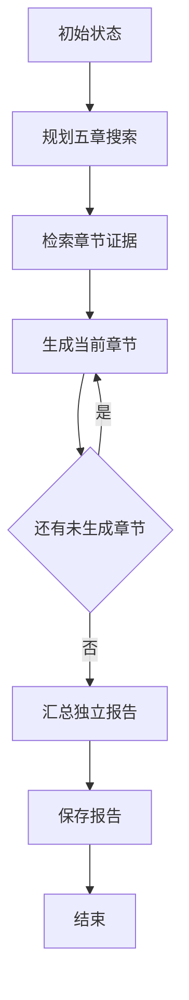

状态会沿着这条流程逐步补充，具体字段变化统一放在后文的状态闭环中说明。

整体结构与私域研究保持一致，但公域侧不需要先做全局召回、章节归属和章节准备。它在规划阶段就以章节为单位设计查询，因此检索结果天然按五章组织。整个流程的第一个关键环节，就是先为五章建立不同的搜索计划。

## 3. 搜索规划

同一个研究主题需要支撑五个职责不同的章节。如果五章直接使用**相同的原始查询**，检索结果会高度重合，背景、传播、观点和深层分析也难以形成差异。因此，正式搜索前需要先把每个章节的证据需求转换成对应的搜索方式和补充搜索词，而这一步我们叫做**搜索规划**，由 `LLM` 完成。`LLM` 只负责决定各章如何搜索，不在规划阶段撰写正文。

规划输入包含三部分：

- 当前研究主题。
- 五个固定章节的标题和公域写作职责。
- 三种可用搜索方式及其能力边界。

规划输出必须保持五项，并与固定章节的原始顺序一一对应。章节规划的每一项包含一种搜索方式和一至三个中文补充搜索词。

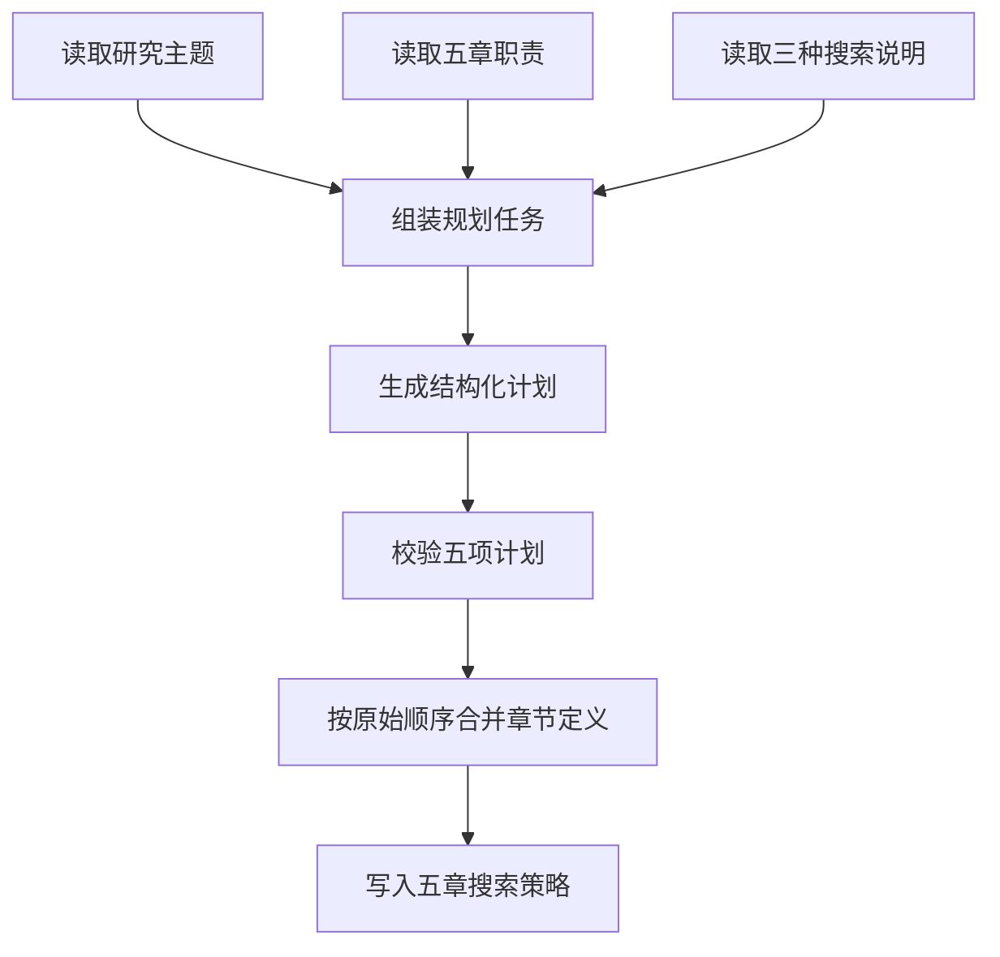

搜索规划与五章职责使用相同的固定顺序，后续根据索引一一合并：第一项搜索规划对应第一章，第二项搜索规划对应第二章，依次形成五个带搜索策略的章节状态。章节键和标题始终来自系统内部的固定定义，`LLM` 只生成各章的搜索方式和补充搜索词。

完成结构对齐后，规划结果需要进入章节状态并在后续节点持续传递，因此先从单个章节的数据模型开始。

### 3.1 章节状态

**MediaSectionState** 表示单个公域章节在图中的状态。它在共享章节字段的基础上增加搜索策略，因此一个章节状态包含：

- **section_key**：章节身份，由固定章节定义提供。
- **title**：章节标题，由固定章节定义提供。
- **body**：章节正文，规划完成时不存在，逐章生成后写入。
- **search_tool**：当前章节选择的一种搜索方式，规划完成后有值。
- **search_keywords**：当前章节规划的一至三个补充搜索词，规划完成后有值。

单个章节状态明确后，还需要一个全局状态把五章及其后续产物组织起来。

### 3.2 全局状态

**MediaState** 表示一次公域研究从开始到结束的全局状态。它保留运行标识、研究主题、角色、章节列表、章节游标和完整报告，同时增加两个公域专属字段：

- **section_evidence_records**：五组章节证据，每一组对应一个固定章节。
- **section_queries**：五组实际查询记录，用于说明每章使用了什么搜索方式和完整查询。

章节列表、章节证据和实际查询始终按相同索引对齐。第一项章节状态使用第一组证据和第一组查询，后续章节依次对应。逐章生成只需要读取当前游标，就能同时取得当前章节及其检索上下文。

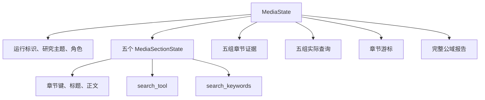

全局状态说明了各类数据如何共存，但搜索规划真正新增的核心内容仍是搜索方式和搜索词。下面先说明搜索方式负责什么。

### 3.3 搜索方式

**search_tool** 是当前章节的检索范围，它解决的是“去哪里搜索”的问题，每个章节只能选择综合搜索、溯源搜索或实时搜索中的一种。

综合搜索强调**广覆盖**；

溯源搜索强调**可溯源**；

实时搜索强调**强时效**；

搜索方式只控制范围，不直接决定具体搜索内容，而具体搜索什么内容则由搜索词进一步确定。

### 3.4 搜索词

**search_keywords** 是章节差异化的核心。它不是完整查询，当执行检索时，系统内部会把研究主题分别与每个补充搜索词组合，每个组合形成一次独立请求。

搜索词主要承担三项职责：

- 将宽泛的研究主题收窄到当前章节。
- 把一个章节拆成多个互补的检索侧重点。
- 在使用同一种搜索方式时，继续拉开不同章节的证据差异。

搜索词不能照搬研究主题；多个搜索词应分别关注不同角度，避免仅替换近义词而产生重复检索。

同一章节的多个搜索词会形成独立查询，因此搜索词的差异会直接影响本章能够召回哪些证据。具体执行和合并方式将在后文展开。

搜索计划确定后，下一步需要把抽象的搜索方式落实到具体服务。这里首先涉及 Anspire 与 Tavily 的取舍。

## 4. 客户端选择

早期设计同时保留 Anspire 和 Tavily 两个搜索客户端，并通过配置决定当前运行使用哪一个。但同一份搜索规划交给不同客户端执行时，能得到不同范围的结果，同时也会增加配置和维护成本。

比如：Tavily 更偏向国际化的通用网页搜索，Anspire 更贴近国内中文信息检索。与此同时，Anspire 还能限定站点和时间范围，并提供可用于后续排序的相关分。

因此，当前项目最终选择 Anspire。这并不意味着它在所有场景都优于 Tavily，而是它更符合当前中文舆情研究对国内信息、站点范围、时间窗口和相关分排序的需求。

客户端确定后，下一步需要回到五章本身，明确每章究竟需要哪些公开证据。

## 5. 五章需求

| 章节 | 公域媒体侧证据需求 |
| --- | --- |
| 事件背景与概览 | 核对公开报道中的事件经过、涉事主体和事实信息。 |
| 舆情热度与传播 | 梳理公开报道和社交网页中的传播节点、热搜线索和扩散过程。 |
| 公众情感与观点 | 归纳公开网页中的观点、争议表达和媒体叙事。 |
| 平台与群体差异 | 比较不同媒体网站和信源类型的报道重点、叙事角度与表达差异。 |
| 深层原因与影响 | 归纳公开报道中的社会背景、成因分析、潜在影响和风险判断。 |

五章分别回答公开事实是什么、信息如何传播、公开如何表达、不同来源有何差异以及公开报道如何解释成因与影响。

**注意**：

私域侧：回答社交媒体样本中的用户在讨论什么、情绪如何以及不同平台之间有何差异。

公域侧：回答公开信息中发生了什么、权威来源和媒体如何叙述，以及外部舆论呈现了哪些观点。

前者提供直接的帖子与评论样本，后者补充公开事实与媒体叙事，从而保证两者形成互补关系。

## 6. 三种搜索

三种搜索方式并不是三个独立客户端，而是同一个 Anspire 客户端上的三套检索策略。它们通过站点范围、时间范围形成差异。先从覆盖面最广的综合搜索开始。

### 6.1 综合搜索

- **特点**：不限制近期时间和指定站点，适合跨来源比较、长期背景和不同媒体叙事分析。
- **优先章节：** **平台与群体差异**、**深层原因与影响**。也可用于**事件背景与概览**、**舆情热度与传播**、**公众情感与观点**。

综合搜索解决跨来源和深层分析问题，而事件背景需要公开事实和正式回应，因此还要使用权威来源更集中的溯源搜索。

### 6.2 溯源搜索

- **特点**：限定官网媒体站点，适合查找官方通报回应和权威报道
- **优先章节：** **事件背景与概览**，也可用于**深层原因与影响**。

溯源搜索解决事实和权威问题，而传播和观点章节需要观察近期公开讨论，因此还要使用具有时间窗口的实时搜索。

### 6.3 实时搜索

- **特点**：限定近一周的微博、知乎和今日头条内容，适合追踪最新进展、热搜线索和社交传播动态，不适合单独承担长期背景分析。
- **优先章节：** **舆情热度与传播**、**公众情感与观点**，也可用于**事件背景与概览**。

由此形成清晰的主要分工：综合搜索负责来源差异和深层分析，溯源搜索负责事件事实，实时搜索负责传播与观点。

三种方式共同覆盖五章，`LLM` 再通过一至三个补充搜索词细化每章的具体检索角度。明确了覆盖关系后，搜索节点就可以将每章计划转换为真实请求。

## 7. 查询执行

前面已经为每章确定搜索方式和补充搜索词，搜索节点不再制定策略，只负责执行计划。它按照固定章节顺序处理五章，将当前章节的一至三个完整查询并发发送，完成后保存本章证据和实际用到查询词，再继续处理下一章，从而保持章节、证据的索引一致。

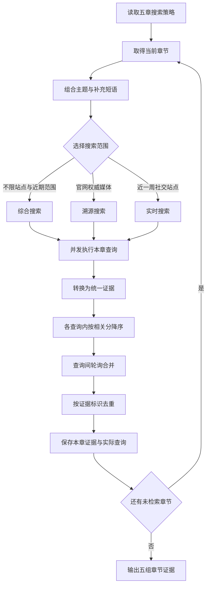

查询执行得到的仍是搜索服务原始结果，进入排序和摘要之前，需要先转换成统一证据。

## 8. 证据统一

检索结果需要先转换为统一证据，后续节点才能脱离 Anspire 的原始响应格式。

| 数据模型 | 核心字段 | 作用 |
| --- | --- | --- |
| `WebpageResult` | `title`、`url`、`content`、`date`、`score` | 保存单条网页结果。 |
| `SearchProviderResponse` | `query`、`webpages` | 保存一次查询及其网页列表。 |
| `EvidenceDocument` | `platform`、`source_table`、`source_id`、`content`、`published_at`、`url`、`title` | 保存标准化网页正文与来源。 |
| `RetrievalMeta` | `matched_queries`、`channel_scores` | 保存命中查询和网页相关分。 |
| `EvidenceRecord` | `document`、`retrieval`、`id` | 形成下游统一使用的证据记录。 |

其中

`platform` ：取网页域名

`source_table` ：固定为网页类型

`source_id` ：优先根据标准化正文生成，正文为空时使用链接。完整证据标识由这三项组成，用于后续去重。

转换完成后，每个章节得到一至三组 `EvidenceRecord`，下一步再对这些结果进行平衡排序。

## 9. 平衡排序

平衡排序只做三件事：查询内按相关分降序、查询间轮询合并、按证据标识去重。核心逻辑如下：

对应的处理流程如下：

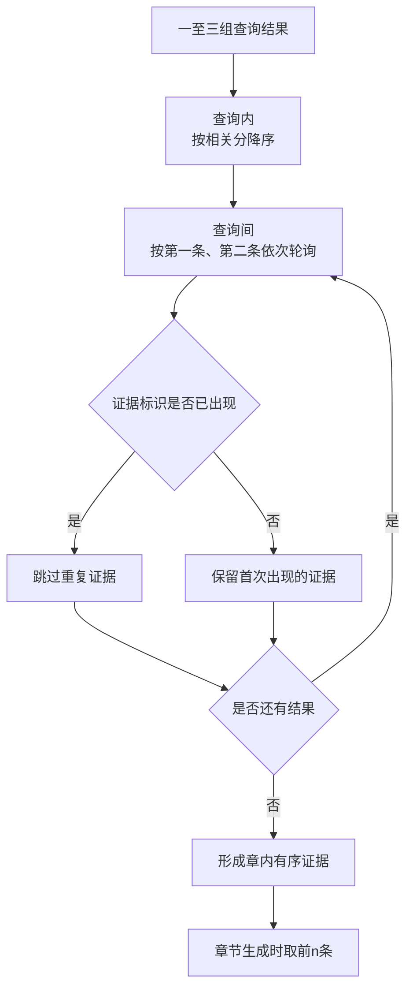


- `ranked_results` 保证每个查询内部高分结果优先。
- `zip_longest` 依次取得各查询的第一条、第二条并继续轮询。
- `seen_ids` 保证同一证据只保留第一次出现的位置。

合并阶段保留全部去重结果，章节生成时最多使用前八条。这种排序只在章节内部进行，不限制同一网页被不同章节分别使用。

排序完成后，五章分别得到一组有序证据，接下来进入正文生成。

## 10. 逐章生成

摘要阶段使用共享的章节循环，每次只处理当前游标指向的一章。公域侧提供媒体分析提示词、实际查询记录和无证据文案，其余游标推进、证据渲染、模型调用和事件发布流程与私域侧一致。

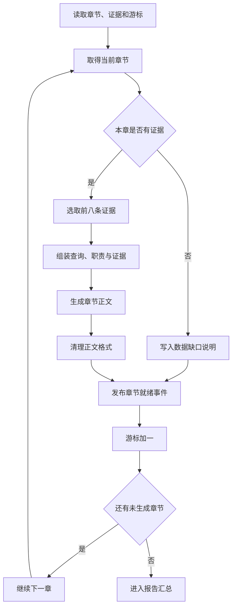

当前章节存在证据时，系统从有序列表中最多渲染前n条，为证据生成章节内编号，并把以下信息交给 `LLM`：

- 本章实际执行的搜索方式和查询词。
- 当前章节标题、章节职责和章节键。
- 带编号的网页证据。

## 11. 报告汇总

报告汇总读取研究主题和五章正文，将每章的标题与正文交给共享报告编辑流程。

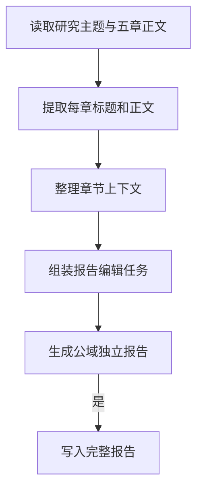

完整公域报告生成后写入状态，随后由保存阶段写入当前运行目录。至此，搜索计划、章节证据、五章正文和独立报告完成了从输入到产物的连续传递。

## 12. 结果保存

保存阶段只消费已经生成的完整报告

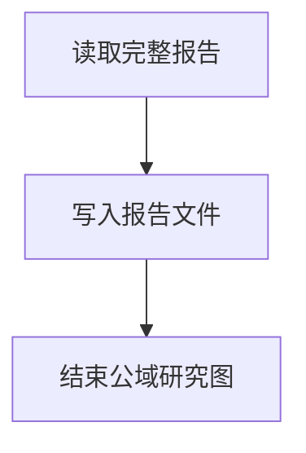

结果保存不新增业务状态，因此图执行结束时仍保留规划、检索、章节和完整报告字段。接下来可以从状态视角检查这些字段如何逐步形成。

## 13. 状态闭环

状态不会在图启动时一次性填满，而是由每个节点返回增量并逐步合并。完整变化顺序如下。

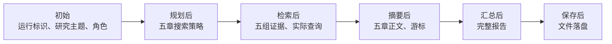

这条状态链从最小输入开始。下面先看研究图启动时具备哪些字段。

### 13.1 初始状态

图启动时只要求三个业务字段，不包含章节、证据、游标或报告。

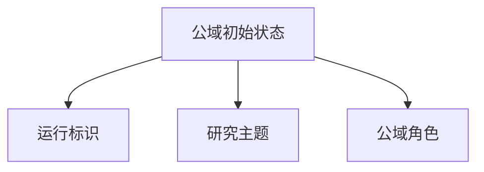

这个最小状态足以启动搜索规划。规划节点不会修改初始字段，只会在它们之上增加五章策略。

### 13.2 规划后

搜索规划完成后，状态首次出现五个固定章节。每章已经具有身份和搜索策略，但还没有正文。

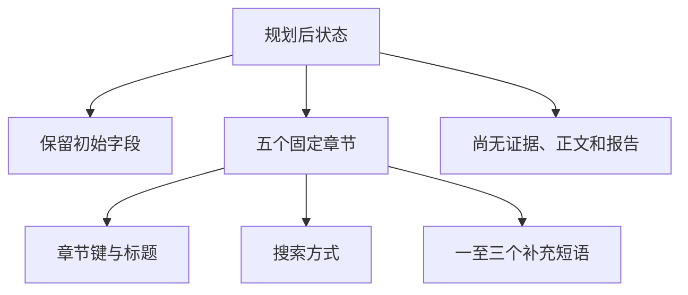

### 13.3 检索后

网页检索完成后，每个章节都拥有一组有序证据和一份实际查询记录。

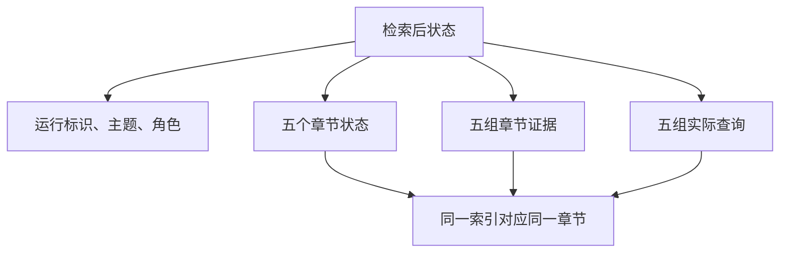

此时还没有任何章节正文。摘要循环会按游标逐次读取同一位置上的章节、证据和查询。

### 13.4 单章生成后

摘要节点每次只更新一个章节。已完成章节获得正文，同时游标向后推进一位，其他章节保持原状。

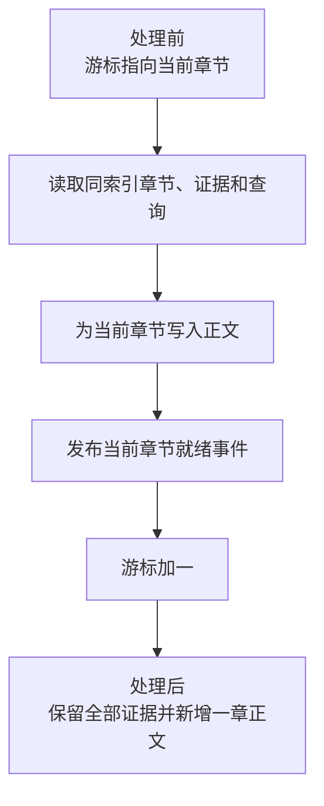

条件边检查新游标，只要还有未完成章节，就把同一状态重新交给摘要节点。这个循环不会重复检索，后续章节继续使用检索阶段已经准备好的证据。

### 13.5 五章完成

第五次摘要完成后，五个章节都带有正文，游标到达章节总数。

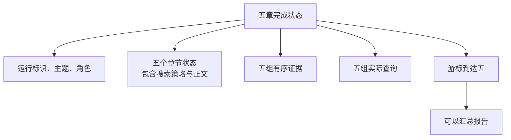

条件边由此退出摘要循环，状态进入报告汇总节点。

### 13.6 汇总后

报告汇总不会覆盖章节正文，而是在现有状态上增加完整公域报告。

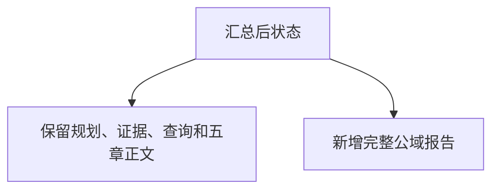

完整报告成为保存节点唯一需要消费的业务字段。保存动作发生在文件系统中，不再向图状态增加新内容。

### 13.7 最终状态

报告保存成功后，图结束。最终状态与汇总后状态相同，额外产物是运行目录中的独立报告文件。

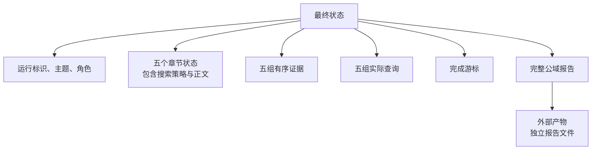

这种以状态连接节点的设计，使公域与私域能够复用逐章生成、报告汇总和结果保存能力，同时分别保留网页检索与私域数据检索两种证据接入方式。

至此，公域研究已经完成从搜索规划、网页检索、证据排序、逐章生成到报告保存的完整闭环。

## 14. 发布订阅案例

```python
#在test包下创建test_sub.py 将代码复制进去运行即可
# 创建事件总线
from datetime import datetime
from typing import Callable, Any

container:dict[str,list] = {}

# 订阅者
def subscribe(event_type:str,call_back:Callable) -> None:
    if event_type not in container:
        container[event_type] = []
    container[event_type].append(call_back)

# 发布者
def publish(event_type:str,event_data:dict[str,Any]) -> None:
    if event_type in container:
        for callback in container[event_type]:
            callback(event_data)

def subscribe_weather(event_data:dict[str,Any]) -> None:
    print(f"收到天气事件类型：{event_data}")

def subscribe_ai(event_data: dict[str, Any]) -> None:
    print(f"收到AI事件类型：{event_data}")

# 订阅：
subscribe("weather",subscribe_weather)
subscribe("ai",subscribe_ai)

# 发布：
publish("weather",{"city":"bj","天气":"晴天"})
publish("ai",{"new":"gpt10","time":datetime.now()})

```


## 15. 总结

公域研究智能体已经形成完整链路：

- `LLM` 根据五章职责规划搜索方式和补充查询搜索词。
- Anspire 统一承载综合、溯源和实时三种搜索策略。
- 三种搜索通过范围差异覆盖五章的不同证据需求。
- 网页结果被转换为带来源、查询、相关分和稳定标识的统一证据。
- 各查询内部按相关分降序排列，多个查询之间轮询合并，并按证据标识去重。
- 摘要阶段从平衡后的顺序中选取前部证据，逐章生成正文并发布事件。
- 五章正文最终汇总为公域独立报告并保存。
