# 08_主持人研判智能体全链路实现

## 1. 角色定位

私域研究智能体和公域研究智能体围绕同一个研究任务，按照固定顺序分别生成五个章节。两者的数据来源和观察角度不同，因此同一章节可能形成一致观点，也可能出现由样本范围、来源结构和叙事重点造成的差异。

主持人智能体不执行新的检索，也不重新生成研究章节。它只接收双方已经完成的同章节正文，在章节配对齐备后完成结构化研判，并把结果交给讨论区和最终报告引擎。

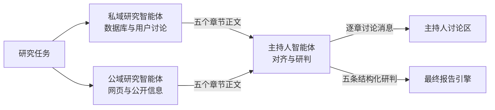

这一定义决定了主持人链路的输入和输出边界。理解边界后，才能继续说明它内部究竟保存什么、何时调用 `LLM`，以及为什么需要事件驱动。

## 2. 输入与输出

主持人链路的直接输入是章节准备事件。每个研究智能体完成一个章节摘要后都会发布一次，因此正常任务中会产生十次输入：私域五次，公域五次。

每条输入只携带四项内容：

| 字段 | 作用 |
|---|---|
| `task_id` | 区分不同研究任务 |
| `source` | 标识章节来自 `insight` 或 `media` |
| `section_key` | 标识固定章节 |
| `body` | 当前 Agent 的章节正文 |

主持人处理这些输入后形成两类输出：

| 输出 | 去向 |
|---|---|
| 讨论事件 | 进入内存讨论缓冲区，供前端轮询展示 |
| 结构化研判 | 五章全部完成后保存为 `host/judgements.json` |

正常情况下，讨论区最终包含十条 Agent 章节消息和五条主持人逐章研判消息。

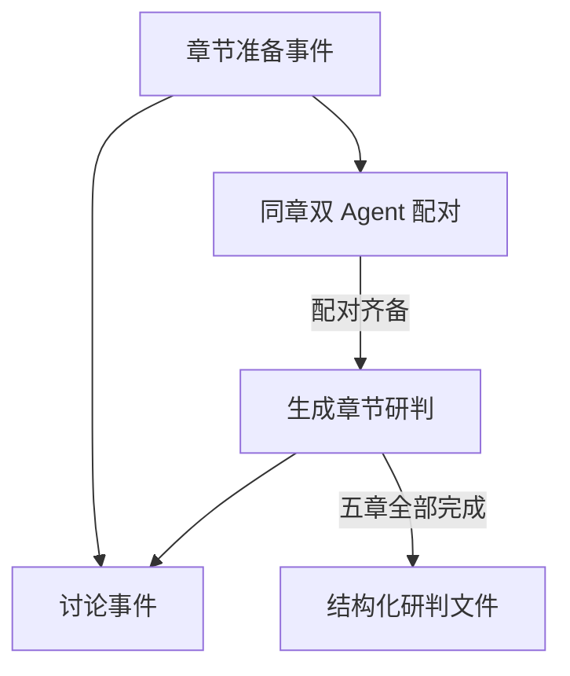

输入和输出明确后，先从完整图流程观察一条事件可能经过哪些节点，再逐步拆解背后的模块、状态和配对机制。

## 3. 图流程

主持人图由四个节点组成：

1. 收集 Agent 输出。
2. 生成章节研判。
3. 应用章节研判。
4. 保存全部研判。

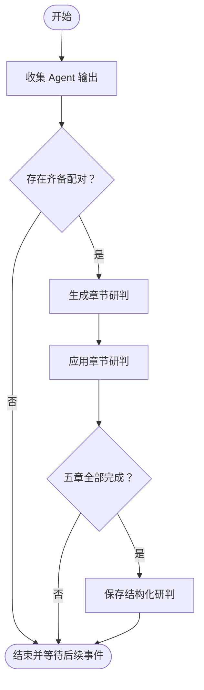

### 3.1 收集

收集节点把当前事件转换为 Agent 章节输出，写入章节配对存储，并立即构造一条 Agent 讨论事件。即使另一方尚未到达，这条原始章节消息也可以进入讨论区。

节点完成后，第一条条件路由调用 `has_ready_pair`。配对不齐时，本次图调用直接结束；配对齐备时才进入 `LLM` 研判。

### 3.2 生成

生成节点通过 `get_ready_pair` 取得按固定顺序排列的第一个待研判配对，然后交给章节研判器。该节点只返回本次 `section_judgement`

### 3.3 应用

应用节点使用研判结果完成三项更新：

- 把当前章节加入已研判集合。
- 把结果追加到 `judgements`。
- 在已有 Agent 讨论事件后追加主持人讨论事件。

第二条条件路由随后检查五个固定章节是否全部进入已研判集合。未完成时结束本次调用；全部完成时进入保存节点。

### 3.4 保存

保存节点把五条 `SectionJudgement` 序列化为 JSON，并写入当前任务的 Host 报告目录。

四个节点构成了 Host 的主路径。接下来再进入主持人包内部，说明这些节点分别依赖哪些模块。

## 4. 内部组成

主持人包将领域模型、状态存储、`LLM` 调用、事件映射和流程编排拆开，每个模块只承担一类职责。

| 模块 | 主要职责 |
|---|---|
| `models.py` | 表示单个 Agent 章节输出和同章节配对 |
| `state.py` | 定义 LangGraph 单次调用需要的状态 |
| `section_pair_store.py` | 跨事件累积章节输出并判断配对是否齐备 |
| `section_judge.py` | 组装研判证据并调用 Host `LLM` |
| `discussion_events.py` | 把领域对象转换为讨论事件 |
| `nodes.py` | 实现收集、生成、应用和保存四个节点 |
| `graph.py` | 定义节点连接和条件路由 |
| `section_ready_listener.py` | 订阅章节准备事件、串行消费并驱动图执行 |

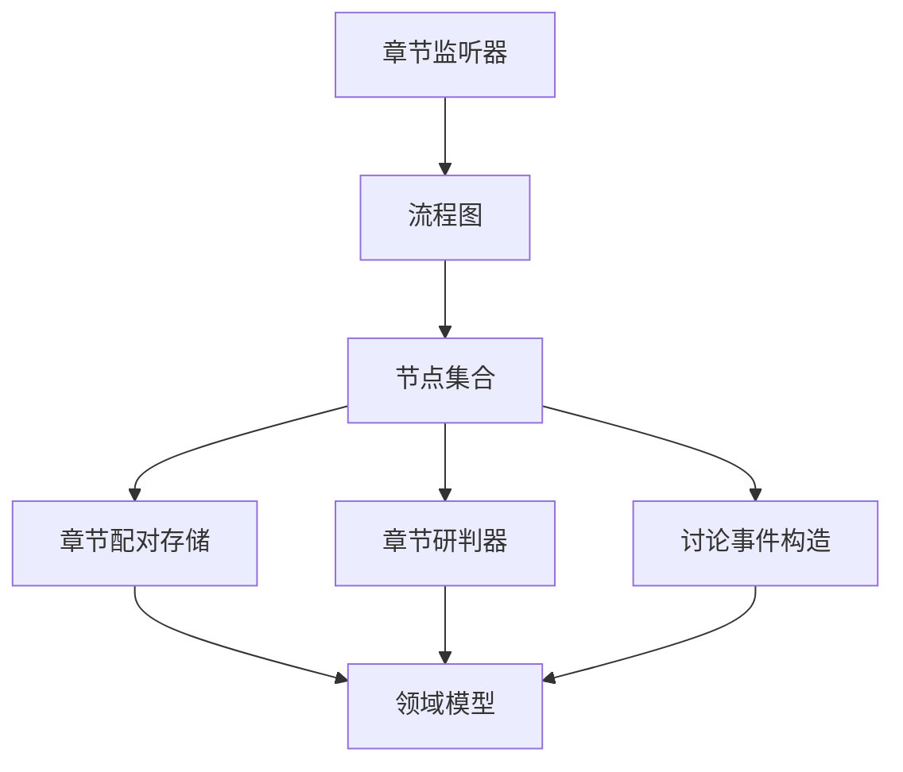

模块之间没有把所有信息塞进一个大对象，而是通过两个层次的状态协作：LangGraph 状态负责单次事件处理，监听器保存需要跨事件延续的数据。

## 5. 状态边界

主持人状态包含六个字段，但它们的生命周期并不相同。

| 字段 | 生命周期 | 作用 |
|---|---|---|
| `task_id` | 跨事件 | 当前研究任务标识 |
| `section_pair_store` | 跨事件 | 累积双方章节输出和已研判章节 |
| `judgements` | 跨事件 | 累积已完成的结构化研判 |
| `event_payload` | 单次事件 | 当前章节准备事件载荷 |
| `discussion_events` | 单次事件 | 当前图调用产生的讨论事件 |
| `section_judgement` | 单次事件 | 生成节点传给应用节点的研判结果 |

监听器使用 `task_id` 维护独立状态。每次事件到来时，它先取出对应任务的持久字段，再加入本次 `event_payload`，形成 LangGraph 的调用状态。图执行结束后，只把 `task_id`、章节配对存储和研判列表写回任务状态。

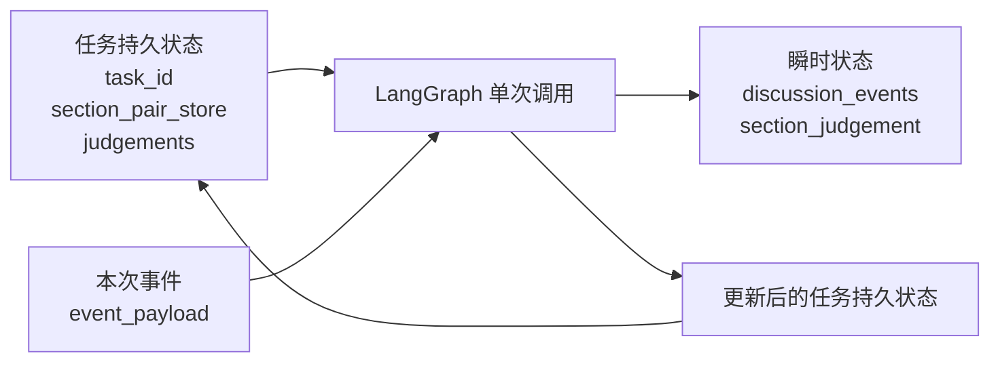


## 6. 章节配对

章节配对存储内部维护两个集合：

- `_outputs_by_section`：按照章节键和来源保存 Agent 输出。
- `_judged_sections`：记录已经完成研判的章节键。

两个结构都以章节键为索引，但保存的内容不同。前者是“章节键 → 来源 → 章节输出”的两层映射，后者只是已完成章节键的集合。下面以背景章节为例展示内部关系：

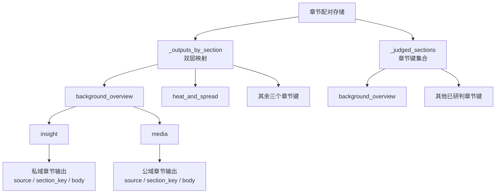

`_outputs_by_section` 负责回答“当前章节已经收到了哪些来源”，`_judged_sections` 负责回答“当前章节是否已经处理完成”。两者结合后，系统才能判断某个章节是否可以进入研判。

单个 Agent 输出只保留 `source`、`section_key` 和 `body`。同一章节的私域和公域输出都存在，并且该章节尚未研判时，章节配对才算齐备。

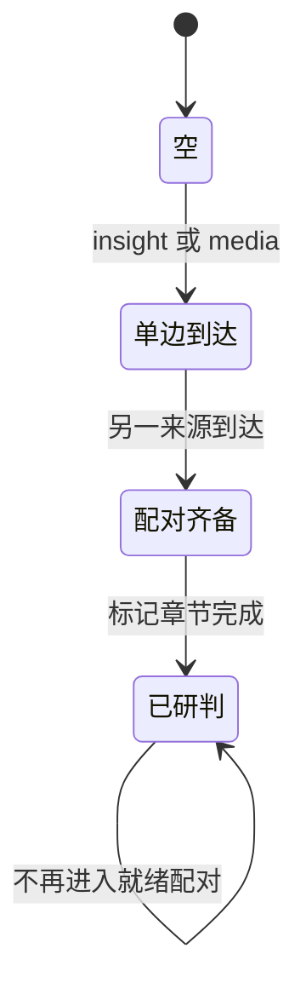

`has_ready_pair` 只负责回答是否存在待研判配对，供图路由使用。确认存在后，`get_ready_pair` 按固定章节顺序取得第一个配对。系统标题来自固定章节定义。

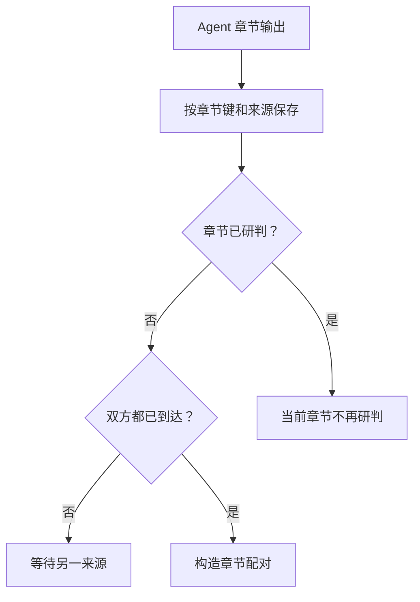

配对存储只负责判断数据是否齐备，不调用 `LLM`。它为前面图流程中的两次条件判断提供状态依据，配对完成后才会进入下一节的章节研判。

## 7. 章节研判

章节研判器从系统定义取得章节键和标题，同时分别截取私域与公域正文的前 3000 个字符，组成当前章节的研判证据。

章节监听器创建 Host 研判器并注入流程图，研判器使用 Host 角色配置初始化统一 `LLMClient`。结构化生成直接复用客户端内置的重试和 JSON Schema 输出能力。

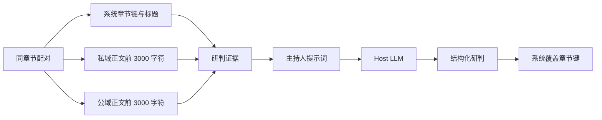

系统提示词规定了两个来源的职责差异，并要求主持人区分共同观点、分歧、信息缺口和综合研判。它还明确限制两类误判：

- 单方缺少信息不能自动视为双方冲突。
- 没有原始证据可核验时，不能仅根据措辞、篇幅或语气判断证据质量。

`LLM` 返回的结构化结果包含：

| 字段 | 含义 |
|---|---|
| `section_key` | 当前章节键，最终由系统强制覆盖 |
| `aligned_points` | 双方一致观点 |
| `conflicts` | 实质性分歧 |
| `evidence_review` | 证据情况与信息缺口 |
| `host_judgement` | 主持人综合研判 |

用于讨论区展示时，结构化章节研判被渲染为“主持人综合研判、双方一致观点、关键分歧、证据情况与信息缺口”四个连续内容块。随后，它会被转换为主持人讨论事件，由章节监听器发布到事件总线，再进入讨论缓冲区。

## 8. 讨论消息

讨论事件构造模块负责把领域对象映射成公共事件模型，避免节点直接处理传输字段。

Agent 消息使用原章节正文，但最多保留前 2000 个字符；主持人消息使用结构化研判渲染后的完整 Markdown。两类消息都携带任务标识、来源和章节键。

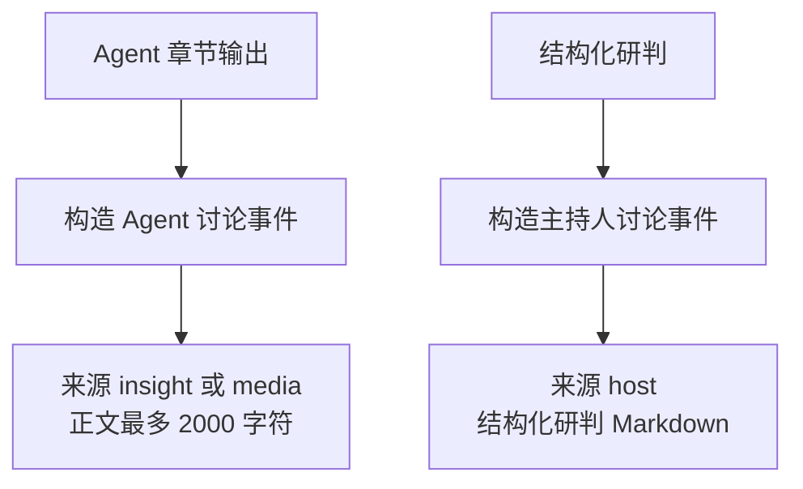

一次只有单边章节到达时，图产生一条 Agent 讨论事件；补齐配对的一方到达时，图产生一条 Agent 事件和一条主持人事件。监听器会在图执行完成后统一发布这些消息。

## 9. 监听执行

章节监听器是 Host 包与公共事件总线之间的入口。启动时，它订阅章节准备事件，创建异步队列，并通过统一任务管理器提交长期运行的消费协程。

事件回调本身不执行研判，只把载荷放入队列。消费协程按顺序取出事件，因此同一进程内只有一个 Host 消费路径修改任务状态，无需为章节配对存储额外加锁。

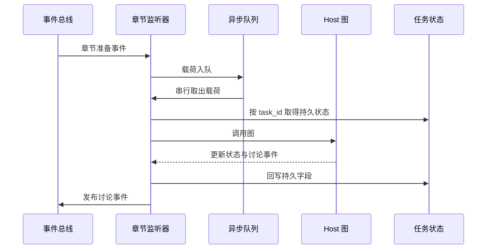

不同任务通过 `_host_states[task_id]` 隔离。任务 A 等待公域章节时，任务 B 可以拥有自己的章节存储和研判列表；事件被串行消费，但状态不会混合。

停止监听器时会取消章节准备事件订阅并清空 Host 任务状态。消费协程不由监听器单独取消，而是在应用关闭时交给统一任务管理器集中取消。

到这里，Host 包内部链路已经闭合。接下来需要说明两个事件怎样由公共事件机制发布和订阅，再沿应用各层到达前端。

## 10. 事件机制

公共事件模块定义了事件类型、载荷模型和发布订阅函数。系统中还有进度、结果和错误事件，但 Host 当前只参与下面两种：

| 事件类型 | 发布方 | 订阅方 | 作用 |
|---|---|---|---|
| `SECTION_READY` | 私域和公域章节摘要节点 | 章节监听器 | 把单个章节正文交给 Host |
| `HOST_DISCUSSION_MESSAGE` | 章节监听器 | Host 服务 | 把 Agent 发言或主持人研判写入讨论缓冲 |

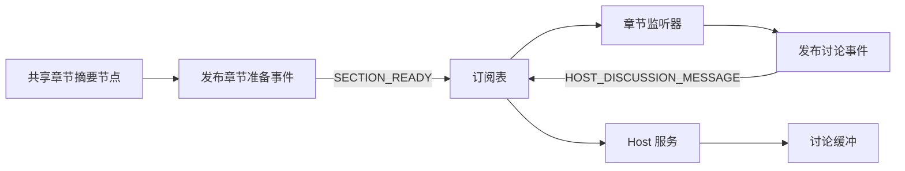

### 10.1 类型

`EventType` 为事件名称提供统一枚举，避免发布方和订阅方使用不一致的字符串。章节准备事件和讨论事件分别使用独立的 Pydantic 载荷模型。

### 10.2 发布

章节摘要节点完成正文后调用统一发布入口。发布入口从研究图状态中读取 `task_id` 和角色，再与章节键、正文组合成章节准备事件。

讨论事件则由监听器在 Host 图执行结束后逐条发布。通用 `publish` 会同步遍历当前事件类型下的全部回调

### 10.3 订阅

`subscribe` 把回调加入对应事件类型的订阅集合。应用启动时，章节监听器订阅章节准备事件，Host 服务订阅讨论事件。

`unsubscribe` 会从全部订阅集合中移除指定回调。应用关闭时，两条 Host 相关订阅都会被解除，避免同进程生命周期再次启动时形成重复回调。

事件总线只在当前进程内工作，不提供跨进程传递和持久化。讨论消息因此还要经过路由、服务和缓冲层，才能成为前端可读取的数据。

## 11. 路由层

Host 路由只暴露一个读取接口：

- 请求方式：`GET`
- 路径：`/api/host/discussion`
- 查询参数：必传 `task_id`
- 响应：当前任务的讨论记录列表

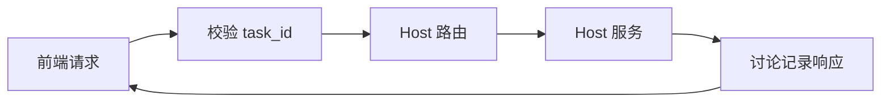

路由不读取内存缓冲，也不处理筛选逻辑。它只接收依赖注入提供的 Host 服务，传入任务标识，并把服务结果包装成响应模型，路由保持轻量后，业务协调自然下沉到服务层。

## 12. 服务层

Host 服务同时持有章节监听器和讨论缓冲区，是应用层管理 Host 能力的统一入口。

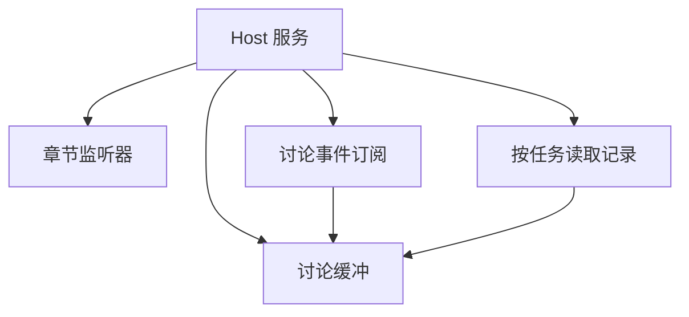

服务层承担四类职责：

1. 注册讨论事件订阅。
2. 启动章节监听器。
3. 接收讨论事件并写入缓冲。
4. 按 `task_id` 返回讨论记录。

讨论事件进入服务后，会被转换为 `DiscussionRecord`。发送时间在写入缓冲时生成，而不是由 Host 图提供。缓冲区按到达顺序保存所有任务记录，读取时再根据 `task_id` 过滤。

服务关闭时分别解除讨论事件订阅并停止章节监听器。服务对象本身由依赖层创建为全局单例，因此监听器和讨论缓冲在一次应用生命周期内保持稳定。

## 13. 依赖层

依赖中心在模块加载时创建一个 Host 服务单例，并通过 `get_host_service` 暴露给 FastAPI。`HostServiceDep` 使用 `Annotated` 和 `Depends` 把该单例注入 Host 路由。

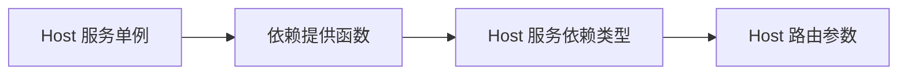

同一个 Host 服务单例还会被注入生命周期管理器。这样，路由读取的讨论缓冲与生命周期启动的监听器属于同一个对象，不会出现启动一个实例、查询另一个实例的情况。

依赖层解决对象身份后，还需要约束层保证事件和接口字段保持一致。

## 14. 约束层

Host 链路存在三组约束，它们分别控制研究章节、主持人研判和 API 响应。

### 14.1 章节约束

这一约束对应 `SectionDefinition` 数据模型，以及由它组成的 `SECTION_DEFINITIONS` 字典。`SectionDefinition` 保存章节键、标题和两类研究 Agent 的章节指导；字典中的五个条目共同确定章节范围与顺序。Insight 与 Media 按这些定义生成正文，Host 的章节配对存储也遍历同一个字典进行配对和完成判断。因此，“全部完成”表示五个已定义章节都已经形成主持人研判。

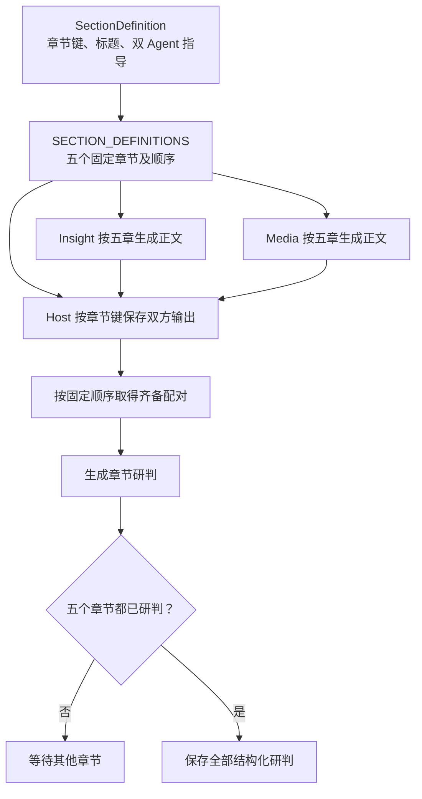

### 14.2 章节研判模型

`SectionJudgement` 规定每条章节研判必须包含哪些字段及其类型。Host 调用 `LLM` 时，先用这个模型校验结构化输出；五章完成后，再把五个模型对象转换为 JSON 保存。报告输入加载器读取文件时，会把每条 JSON 再次校验为同一个模型，确认文件结构没有缺失或类型错误后才交给报告引擎。

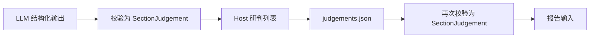

因此，这个模型同时约束 Host 的生成结果和报告引擎接收的输入。两端使用同一套字段定义，避免一端保存任意字典、另一端只能猜测字段是否存在。

### 14.3 接口约束

讨论接口使用两层响应模型：

| 模型 | 核心字段 |
|---|---|
| 单条讨论记录 | `task_id`、`source`、`message_text`、`sent_at`、`dimension_key` |
| 讨论记录响应 | `discussion_records` 列表 |

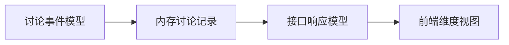

事件侧使用 `content` 和 `section_key`，接口侧使用 `message_text` 和 `dimension_key`。这次命名转换发生在讨论缓冲区，明确区分内部事件语义和前端展示语义。

约束定义完数据形状后，生命周期层负责保证这些订阅和后台任务在正确时间存在。

## 15. 生命周期层

应用启动时，生命周期管理器按顺序注册实时广播服务、Host 讨论缓冲订阅和章节监听器。Host 必须在研究任务开始发布章节事件之前完成订阅，才能接收完整的十条章节消息。

应用关闭时，生命周期管理器先停止事件接收，再统一取消后台任务，最后释放检索后端资源。

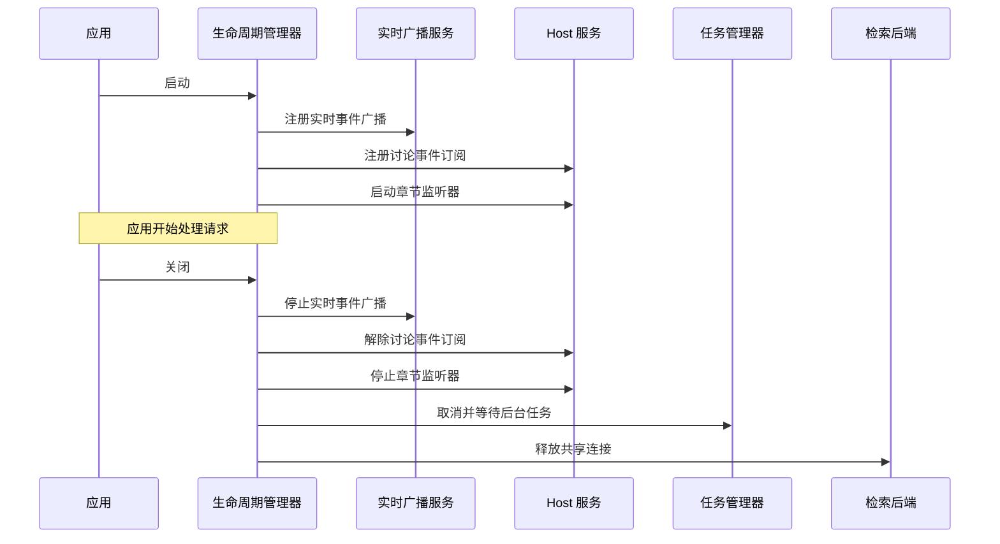

章节监听器的消费协程由任务管理器统一登记，因此生命周期关闭时不需要在监听器内部重复等待任务。停止监听器仍然负责解除自身订阅和清空任务状态，两层职责互不重叠。

生命周期准备完成后，最外层应用只需把启动关闭逻辑和 Host 路由装配进 FastAPI。

## 16. 应用层

应用模块先创建 FastAPI 实例、注册异常处理器并挂载全部路由。服务真正启动后才进入 lifespan，取得全局生命周期管理器并调用注册方法；退出时通过 `finally` 调用异步关闭方法，因此正常关闭和异常退出都会进入资源释放流程。

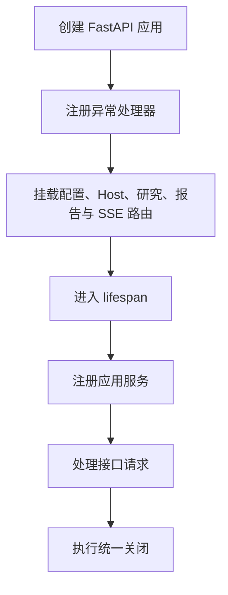

Host 路由与研究、报告、配置和 SSE 路由一起挂载到同一个应用。章节准备事件和讨论事件不通过 HTTP 在后端内部流转，HTTP 只负责让前端读取已经进入缓冲区的讨论记录。

应用装配到这里已经完成，最后再把前端轮询和报告消费接上，形成真正的交付闭环。

## 17. 结果交付

前端讨论视图监听当前 `taskId`。当 `taskId `首次设置或切换时，前端立即查询一次该任务的讨论记录，随后每三秒轮询更新。再每三秒轮询一次。记录按照五个固定章节分组，每组分别提取最新的私域消息、公域消息和主持人消息，当五个章节都出现主持人研判后，前端停止轮询。

```mermaid
flowchart LR
    TaskId["当前 taskId"]
    Poll["立即请求并每三秒轮询"]
    Api["讨论接口"]
    Group["按五章分组"]
    Complete{"五章都有 Host 研判？"}
    Continue["继续轮询"]
    Stop["停止轮询"]

    TaskId --> Poll --> Api --> Group --> Complete
    Complete -->|否| Continue --> Poll
    Complete -->|是| Stop
```

与此同时，保存节点生成的 `judgements.json` 不进入讨论接口。报告输入加载器会先确认私域报告、公域报告和 Host 研判文件都已经存在；准备检查通过后，实际加载阶段只读取 `judgements.json`，逐条校验为 `SectionJudgement` 并交给报告引擎。私域和公域报告在这里承担完整性门槛，不会再次作为正文输入。

```mermaid
flowchart LR
    InsightReport["私域报告存在"]
    MediaReport["公域报告存在"]
    HostJson["host/judgements.json"]
    Ready{"三类产物齐备？"}
    Validate["读取 Host JSON<br/>并执行结构化模型校验"]
    ReportInput["最终报告输入"]
    ReportEngine["最终报告引擎"]

    InsightReport --> Ready
    MediaReport --> Ready
    HostJson --> Ready
    Ready -->|是| Validate
    Validate --> ReportInput
    ReportInput --> ReportEngine
```

讨论区解决过程展示，结构化文件解决后续报告生成，两条输出路径共享同一批逐章研判，但不会互相依赖。

## 18. 完整时序

把前面的内部流程和应用层连接起来，一次正常任务的完整时序如下。

```mermaid
sequenceDiagram
    participant Insight as 私域研究智能体
    participant Media as 公域研究智能体
    participant Bus as 事件总线
    participant Listener as 章节监听器
    participant Graph as Host 图
    participant Judge as 章节研判器
    participant LLM as Host LLM
    participant HostService as Host 服务
    participant Buffer as 讨论缓冲
    participant Frontend as 前端
    participant Files as 任务产物

    loop 五个章节分别完成
        Insight->>Bus: 发布章节准备事件
        Bus->>Listener: 事件入队
        Listener->>Graph: 收集私域章节
        Graph-->>Listener: Agent 讨论事件
        Listener->>Bus: 发布讨论事件
        Bus->>HostService: 接收讨论事件
        HostService->>Buffer: 追加私域消息

        Media->>Bus: 发布章节准备事件
        Bus->>Listener: 事件入队
        Listener->>Graph: 收集公域章节
        Graph->>Judge: 传入当前章节配对
        Judge->>LLM: 发送章节信息、双方正文片段和研判要求
        LLM-->>Judge: 返回结构化章节研判
        Judge-->>Graph: 返回 SectionJudgement
        opt 当前为最后一个待研判章节
            Graph->>Files: 保存 judgements.json
        end
        Graph-->>Listener: Agent 事件与主持人事件
        Listener->>Bus: 逐条发布讨论事件
        Bus->>HostService: 接收讨论事件
        HostService->>Buffer: 追加公域与主持人消息
    end

    loop 每三秒直到五章研判齐备
        Frontend->>HostService: 通过接口查询 task_id
        HostService->>Buffer: 按任务筛选
        Buffer-->>Frontend: 返回讨论记录
    end
```

实际事件到达顺序可以交错，某一章也可能由公域先到达。章节配对存储只关心同一 `section_key` 的两个来源是否齐备，因此先后顺序不会改变最终研判结果的章节归属。

## 19. 总结

主持人链路以章节准备事件为入口，以同章双 Agent 配对为触发条件，通过四节点 LangGraph 完成逐章研判。监听器按任务保存跨事件状态，公共事件总线负责进程内传递，Host 服务把讨论事件沉淀到内存缓冲，路由再按任务提供给前端。

五章全部研判后，系统只保存结构化 JSON,前端通过五章主持人消息判断完成，报告引擎则直接消费结构化研判文件。由此，过程展示与最终报告各自独立，同时共享同一套可信的主持人研判结果。
