# 09_舆情多Agent全链路打通

## 1. 主持人讨论消息进入应用层

Host Agent 完成的 Agent 发言和章节研判首先以 `HOST_DISCUSSION_MESSAGE` 事件存在于引擎层。应用层不会直接读取 Host 图状态，而是通过订阅事件，把消息转换为适合 REST 接口和前端展示的讨论记录。

### 1.1 讨论消息的发布边界

Host 图会产生两类讨论消息：

- 收集 Insight 或 Media 章节结果时，生成对应 Agent 的章节发言。
- 同章节双方结果齐备并完成研判后，生成 Host 的章节研判发言。

`SectionReadyListener` 执行完一次 Host 图后，遍历本次产生的 `discussion_events`，再通过事件总线发布。Host 图负责生成内容，监听器负责把内容送出，两者之间没有直接调用应用服务。

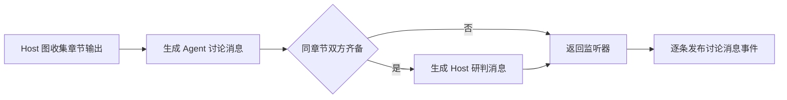

### 1.2 应用缓冲区的订阅

应用启动时，`HostService.register_discussion_buffer` 将内部回调订阅到 `HOST_DISCUSSION_MESSAGE`。事件到达后，回调立即调用 `DiscussionBuffer.append_message`，将引擎事件转换为应用记录。

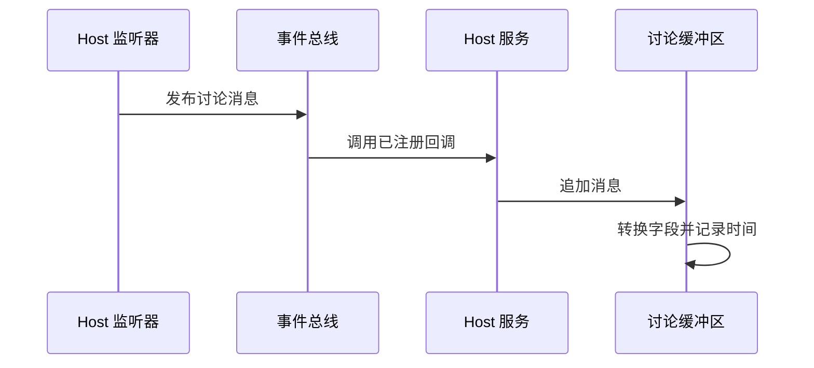

### 1.3 按研究任务隔离消息

每条讨论消息都携带 `task_id`。`DiscussionBuffer` 当前使用一个全局列表保存所有任务的记录，写入时不按任务拆分，读取时再通过 `task_id` 过滤。

这种方式足以支持单进程下的多任务隔离，但缓冲数据不会自动清理，也不会跨进程持久化。应用重启后，磁盘中的研判文件仍然存在，讨论区内存消息则会消失。

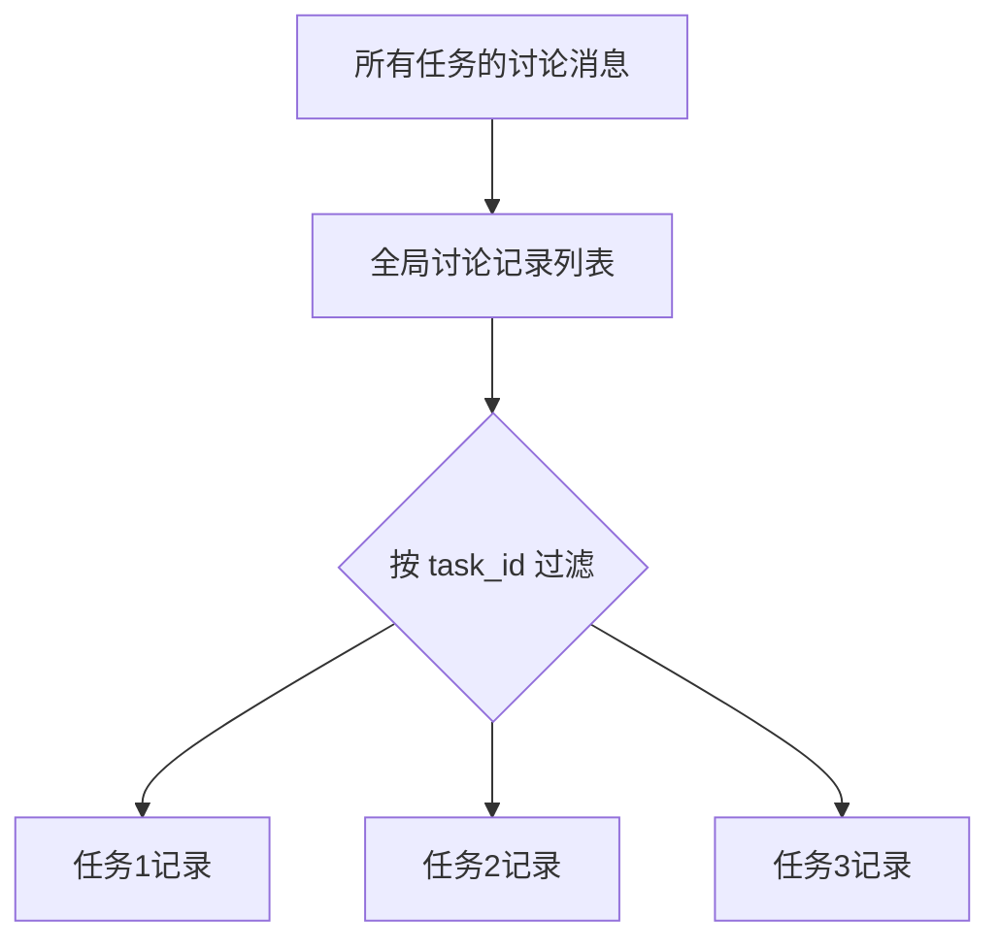

### 1.4 讨论记录的追加与读取

写入缓冲区时会发生一次字段转换：

- `content` 转换为 `message_text`。
- `section_key` 转换为 `dimension_key`。
- 当前时间转换为 `sent_at`。
- `task_id` 和 `source` 原样保留。

读取链路从 `GET /api/host/discussion` 开始，经 Host 路由、Host 服务进入讨论缓冲区，最终返回 `discussion_records`。

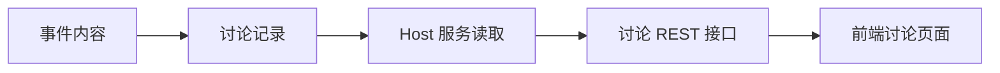

### 1.5 前端轮询与五章展示

`HostDiscussionView` 根据当前 `taskId` 每三秒读取一次讨论接口。返回记录按 `dimension_key` 分配到五个固定章节，再分别选取 Insight、Media 和 Host 的最新消息。Host 区域，展示数据完全来自讨论缓冲接口，没有直接读取 `judgements.json`

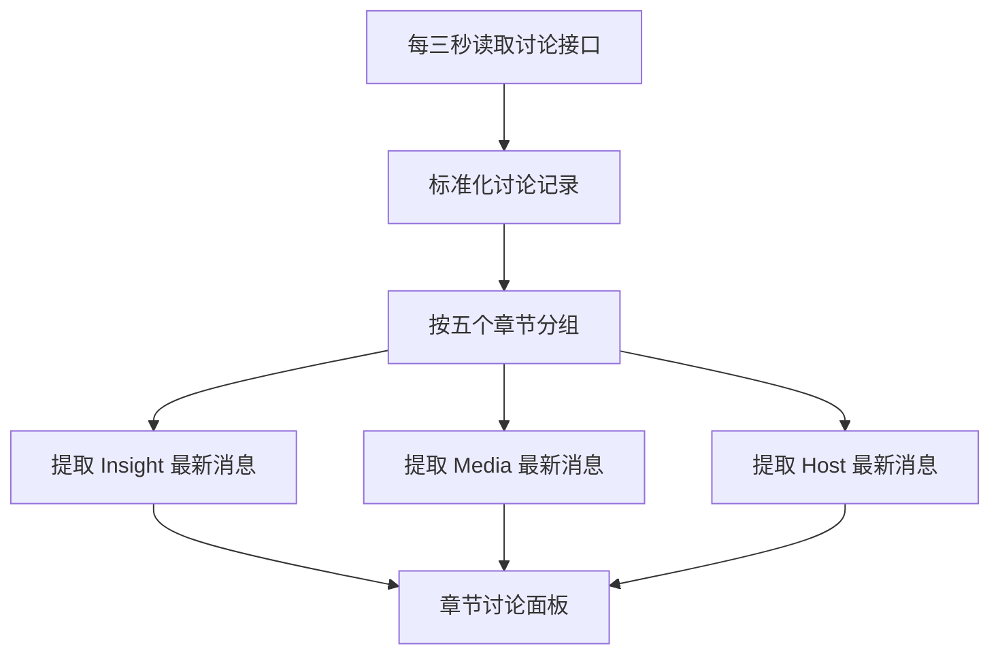

### 1.6 讨论完成后的轮询停止

前端对五个章节逐一检查 Host 消息。五章都有 Host 研判时，认为讨论完成并停止轮询。后端的完成依据是五章均已写入 `SectionJudgement`，前端的完成依据则是五章均存在 Host 讨论消息。

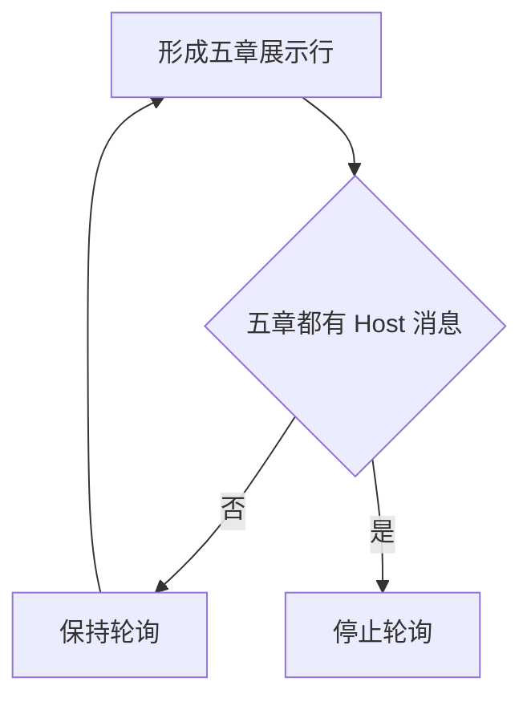

讨论消息解决了运行期间的展示问题，而综合报告还需要稳定的磁盘输入，因此下一步进入研究成果的持久化契约。

## 2. 研究成果的持久化契约

系统以 `task_id` 作为任务目录，以角色作为子目录。运行时事件用于即时协作，磁盘文件用于跨阶段交接，两者共同构成完整链路。

### 2.1 按任务隔离的目录结构

默认运行时根目录为项目下的 `var`。每个研究任务拥有独立目录，Insight、Media、Host 和 Report 分别写入自己的子目录。

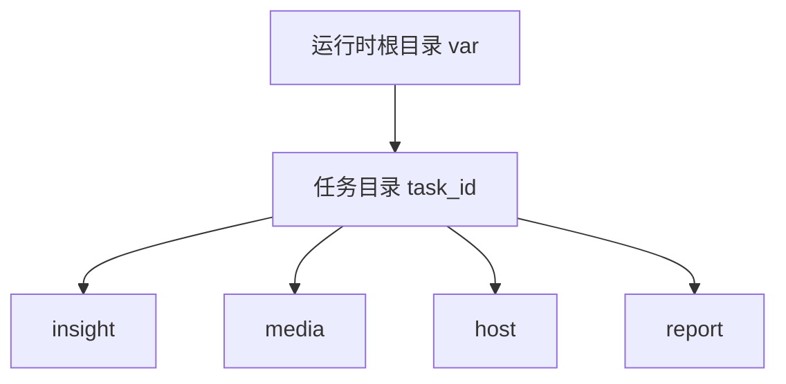

### 2.2 双研究报告的固定文件名

Insight 和 Media 的图都以报告生成节点和报告保存节点结束。两个角色虽然使用不同目录，但独立报告都固定保存为 `report.md`：

- `var/{task_id}/insight/report.md`
- `var/{task_id}/media/report.md`

固定文件名让保存端和读取端形成明确契约，也避免研究主题中的特殊字符进入路径。

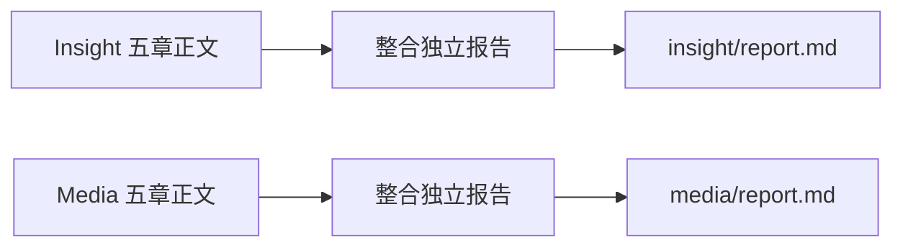

### 2.3 主持人结构化研判文件

Host 不再生成独立 Markdown 报告。五章全部研判完成后，Host 图把 `SectionJudgement` 列表序列化为：

`var/{task_id}/host/judgements.json`文件中的每章包含章节键、一致观点、关键分歧、证据审视和主持人综合研判。

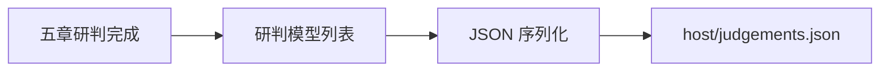

### 2.4 综合报告的生成批次文件

同一研究任务可以在前一次生成完成后再次生成综合报告，因此最终报告不使用固定文件名，而是使用 `generation_id` 区分生成批次：

- `var/{task_id}/report/{generation_id}.md`
- `var/{task_id}/report/{generation_id}.html`

任务目录解决研究隔离，生成批次解决同一任务内的多次报告生成。

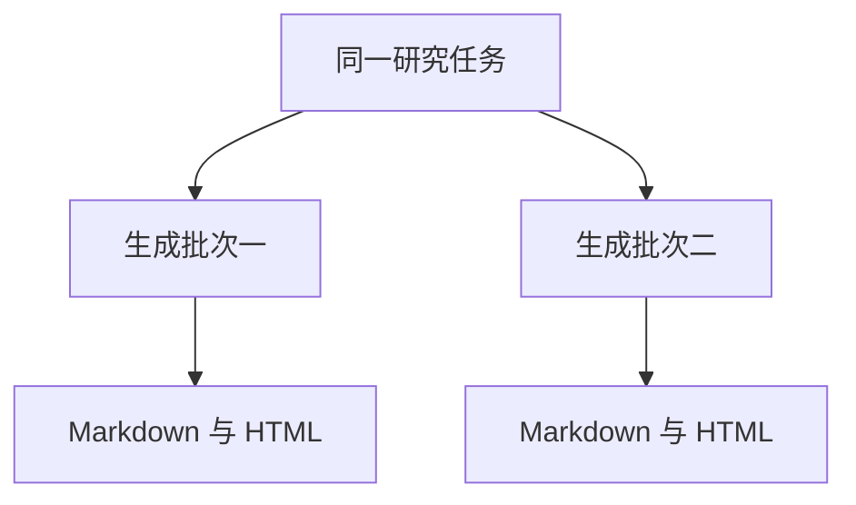

### 2.5 运行时状态与磁盘状态的边界

研究任务登记、Host 状态、讨论缓冲和报告生成记录都保存在内存中。其中，`ResearchTask` 只保存 `task_id` 与原始研究主题，真正的报告由它关联的双 Agent 后台任务生成；`ReportGeneration` 保存一次综合报告生成的输入、状态、输出和错误信息，最终文件则由报告引擎写入磁盘。

Host 状态中的结构化研判会保存为 JSON，双 Agent 和报告引擎也会分别持久化自己的报告。讨论缓冲只服务于当前进程中的前端轮询，没有对应的磁盘产物，应用重启后其中的消息会丢失。

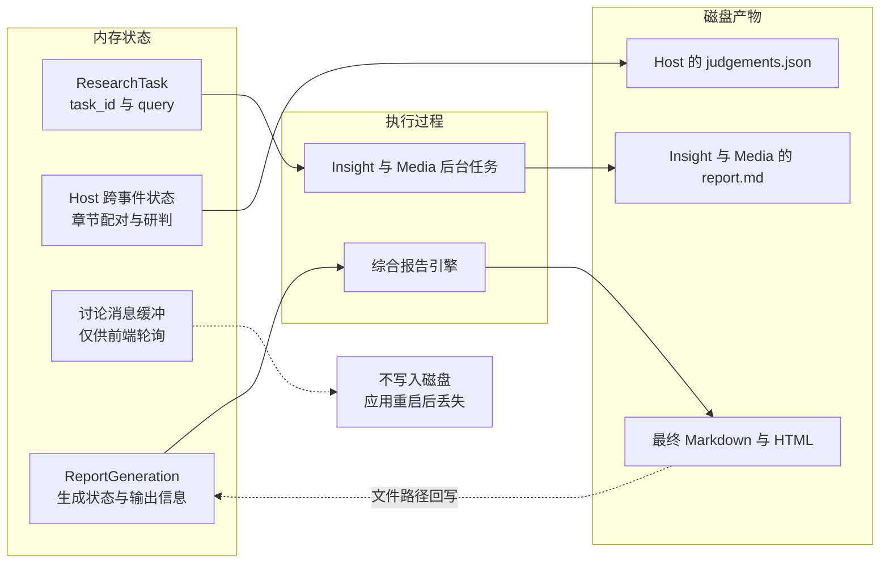

### 2.6 已完成研究结果的读取

研究结果接口遍历 Insight 和 Media 两个角色目录，只读取已经存在的 `report.md`。某个角色尚未落盘时，该角色不会出现在结果字典中。

前端接收到角色完成事件后，会调用研究结果接口读取真正的报告正文。事件只负责通知完成，正文通过 REST 和磁盘取得。

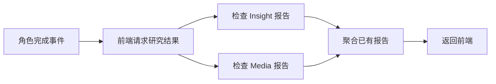

三类上游文件形成报告输入边界，接下来需要判断它们是否已经齐备。

## 3. 综合报告生成条件

综合报告不会根据 Agent 的内存状态启动，而是以三类输入文件是否存在作为前置条件。

### 3.1 三类必要输入

报告生成依赖：

- Insight 独立报告。
- Media 独立报告。
- Host 五章结构化研判。

三者缺一不可。双 Agent 报告提供完整原始叙述，Host 研判提供跨来源对齐后的结论边界。

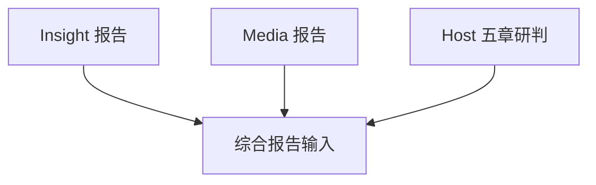

### 3.2 输入文件检查

`ReportInputLoader.get_report_input_status` 根据 `task_id` 构造三个固定路径，并逐一检查文件是否存在。

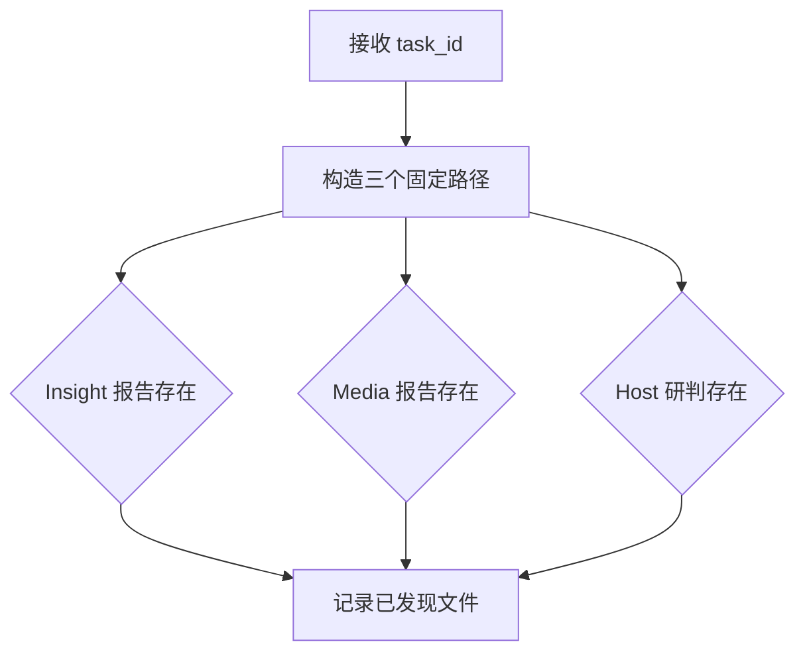

### 3.3 已发现文件与内部路径

检查结果形成 `ReportInputStatus`：

- `task_id` 标识研究任务。
- `found_files` 用于向前端展示已发现文件数量。
- `input_file_paths` 保存角色到绝对路径的内部映射。
- `prepared` 根据内部路径数量计算。

前端只接收 `task_id`、`prepared` 和 `found_files`，绝对路径不会通过接口暴露。

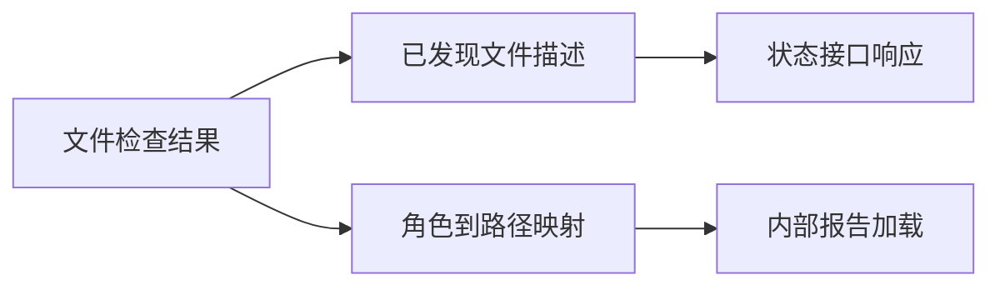

### 3.4 就绪状态计算

当前就绪规则是 `input_file_paths` 中恰好收集到三个角色键。Host 的 `judgements.json` 只在五章全部研判后生成，因此 `prepared=true` 同时意味着：

- 两个研究 Agent 均已完成独立报告。
- Host 已完成全部五章研判。

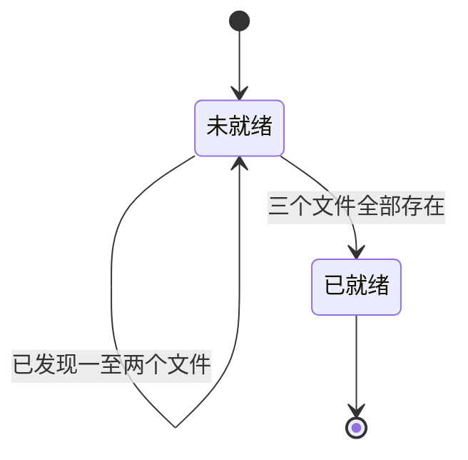


输入就绪后，系统才会建立一次独立的报告生成过程。

## 4. 综合报告生成任务

报告生成是异步任务。HTTP 请求只负责建立生成记录并提交后台协程，不等待 LLM 和文件渲染完成。

### 4.1 用户发起生成请求

前端向报告生成接口提交 `task_id`。报告服务重新检查输入状态，防止前端缓存的就绪状态已经失效。

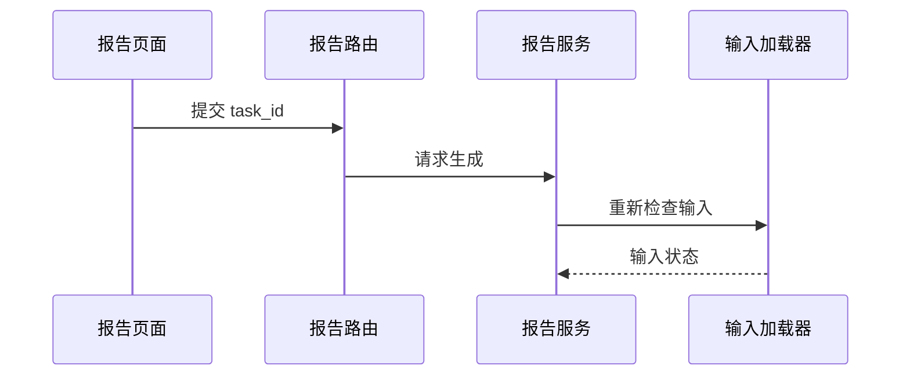

### 4.2 同一研究任务的重复生成约束

报告服务遍历当前内存中的生成记录。如果同一 `task_id` 已经存在 `RUNNING` 记录，则拒绝再次启动；已经完成或失败的历史记录不会阻止新的生成批次。

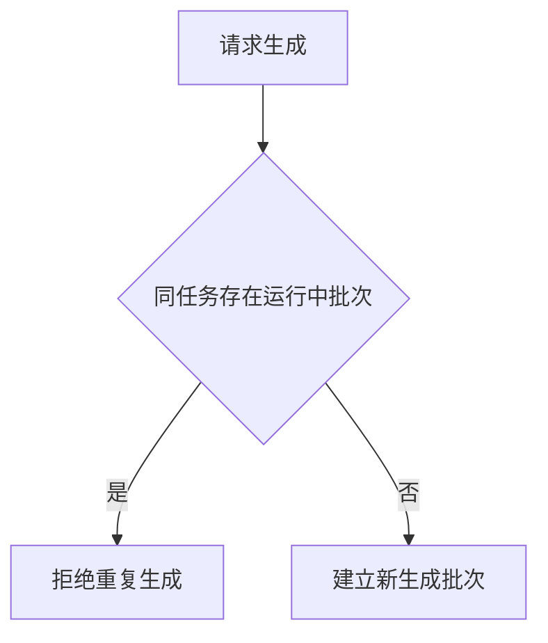

### 4.3 生成批次的建立

新批次使用 `generation_` 前缀和随机 UUID 形成 `generation_id`。随后读取三方输入并构造 `ReportInput`，再创建初始状态为 `RUNNING` 的 `ReportGeneration`。

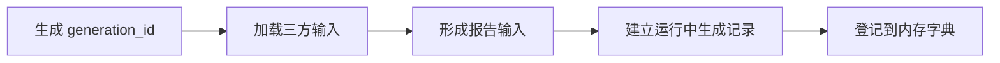

### 4.4 后台生成任务提交

生成记录建立后，报告服务通过统一任务管理器提交 `_run_report_generation`。接口立即返回 `generation_id` 和 `task_id`，前端据此开始轮询。

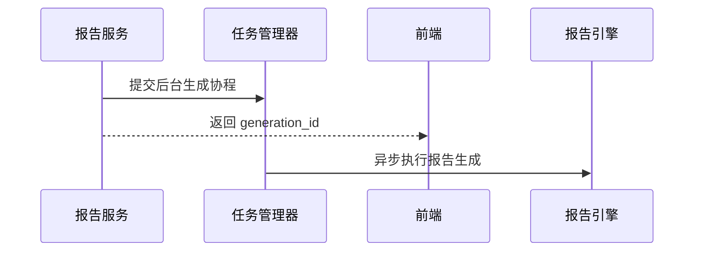

### 4.5 运行、完成与失败状态

`ReportGenerationStatus` 包含三种状态：

- `RUNNING`：已经提交但尚未完成。
- `COMPLETED`：已经绑定 `ReportOutput`。
- `ERROR`：记录了错误消息。

```mermaid
stateDiagram-v2
    [*] --> RUNNING
    RUNNING --> COMPLETED: 引擎成功返回
    RUNNING --> ERROR: 引擎抛出异常
    COMPLETED --> [*]
    ERROR --> [*]
```

### 4.6 生成记录与报告输出的关系

`ReportGeneration` 持有输入、状态、错误信息和可选输出。`generation_id` 与 `task_id` 都从内部 `ReportInput` 暴露

```mermaid
classDiagram
    class ReportGeneration {
        report_input
        report_output
        status
        error_message
    }
    class ReportInput {
        generation_id
        task_id
        query
        insight_report
        media_report
        host_judgements
    }
    class ReportOutput {
        html_content
        report_filepath
        report_filename
        markdown_filepath
        markdown_filename
    }
    ReportGeneration --> ReportInput
    ReportGeneration --> ReportOutput
```

生成记录建立之后，真正的内容生产从统一报告输入开始。

## 5. 综合报告输入组装

`ReportInputLoader.load_report_input` 把运行时任务信息和三类磁盘文件合并为一次不可分割的报告输入。

### 5.1 恢复原始研究主题

`task_id` 只用于系统关联，最终报告还需要用户可读的研究主题。输入加载器通过 `research_task_manager` 找到原始 `ResearchTask`，读取其中的 `query`。

```mermaid
flowchart LR
    A[task_id] --> B[研究任务管理器]
    B --> C[ResearchTask]
    C --> D[恢复 query]
```

### 5.2 读取私域研究报告

加载器通过就绪检查阶段保存的路径读取 Insight `report.md` 全文。

```mermaid
flowchart LR
    A[Insight 文件路径] --> B[读取 Markdown 全文]
    B --> C[insight_report]
```

### 5.3 读取公域研究报告

Media 输入同样读取固定的 `report.md`。

```mermaid
flowchart LR
    A[Media 文件路径] --> B[读取 Markdown 全文]
    B --> C[media_report]
```

### 5.4 读取主持人章节研判

Host 文件先解析为 JSON 列表，再逐项通过 `SectionJudgement.model_validate` 恢复结构化模型。与直接传入一段 Host Markdown 相比，这种方式能明确区分五章以及每章内部的四类研判字段。

```mermaid
flowchart LR
    A["judgements.json"] --> B[解析 JSON 列表]
    B --> C[逐项模型校验]
    C --> D[Host 研判模型列表]
```

### 5.5 形成统一报告输入

最终 `ReportInput` 同时包含：

- 当前生成批次标识。
- 研究任务标识。
- 原始研究主题。
- Insight 报告全文。
- Media 报告全文。
- Host 五章结构化研判。

```mermaid
flowchart TD
    A[generation_id] --> G[统一报告输入]
    B[task_id] --> G
    C[query] --> G
    D[Insight 报告] --> G
    E[Media 报告] --> G
    F[Host 研判] --> G
```

统一输入将三条上游链路收口，下一步由报告角色组织最终内容。

## 6. 综合报告内容生成

报告引擎把章节定义、Host 研判和双 Agent 原始报告一起交给报告角色 LLM，直接生成最终 Markdown。

### 6.1 固定章节上下文

报告引擎从 `SECTION_DEFINITIONS` 提取五章的 `section_key` 和 `title`，为最终报告提供稳定顺序和章节边界。

```mermaid
flowchart LR
    A[固定章节定义] --> B[提取章节键]
    A --> C[提取章节标题]
    B --> D[章节上下文]
    C --> D
```

### 6.2 主持人研判的结构化转换

每个 `SectionJudgement` 转换为普通字典，再整体序列化为带缩进的 JSON。结构化内容是最终结论的主要约束，防止最终报告忽略双方冲突和证据缺口。

```mermaid
flowchart LR
    A[研判模型列表] --> B[转换为字典]
    B --> C[序列化 JSON]
    C --> D[研判提示上下文]
```

### 6.3 双研究报告的原文注入

Insight 和 Media 报告全文直接进入用户提示词。它们用于补充 Host 结构化结论之外的细节、案例、证据和叙述背景。

```mermaid
flowchart TD
    A[Insight 原始报告] --> C[报告提示上下文]
    B[Media 原始报告] --> C
    D[Host 研判] --> C
```

### 6.4 最终提示上下文组装

用户提示由研究主题、五章上下文、Host 研判 JSON 和双 Agent 报告组成。系统提示负责限定报告角色、事实边界、章节组织和输出格式。

```mermaid
flowchart TD
    A[研究主题] --> F[用户提示]
    B[章节上下文] --> F
    C[Host 研判] --> F
    D[Insight 报告] --> F
    E[Media 报告] --> F
    F --> G[报告角色 LLM]
    H[系统提示] --> G
```

### 6.5 报告角色生成最终正文

`LLMClient.from_role("report")` 使用报告角色独立的模型配置。调用成功后直接返回 Markdown 字符串，随后进入渲染与保存阶段。

```mermaid
sequenceDiagram
    participant E as 报告引擎
    participant L as 报告角色 LLM
    participant R as Markdown 正文

    E->>L: 系统提示与用户提示
    L-->>E: 生成 Markdown
    E->>R: 保存生成结果
```

Markdown 是内容主版本，而面向浏览器的交付还需要 HTML 渲染。

## 7. 报告渲染与文件保存

报告引擎在同一次生成中同时产出 Markdown 和完整 HTML，保证编辑能力与直接阅读能力并存。

### 7.1 最终正文的 Markdown 形态

```mermaid
flowchart LR
    A[LLM 输出] --> B[最终 Markdown]
    B --> C[Markdown 文件]
    B --> D[HTML 渲染输入]
```

### 7.2 Markdown 到网页内容的转换

`render_markdown` 使用 Mistune 把 Markdown 转换为 HTML body。标题、列表、引用和表格等结构在这一阶段变成浏览器可识别元素。

```mermaid
flowchart LR
    A[Markdown] --> B[Mistune 渲染]
    B --> C[HTML 内容片段]
```

### 7.3 完整网页模板封装

`render_html` 把 HTML body 放入完整页面模板，并将研究主题写入页面标题。样式以内联 CSS 保存，使最终 HTML 可以脱离前端应用独立打开。

```mermaid
flowchart TD
    A[HTML 内容片段] --> D[完整网页]
    B[研究主题] --> D
    C[内联样式] --> D
```

### 7.4 双格式文件落盘

报告目录由 `task_id` 决定，文件名由 `generation_id` 决定。Markdown 和 HTML 使用同一生成批次标识，天然形成配对。

```mermaid
flowchart LR
    A[最终 Markdown] --> B["generation_id.md"]
    C[完整 HTML] --> D["generation_id.html"]
    B --> E["任务 report 目录"]
    D --> E
```

### 7.5 报告输出元数据形成

保存完成后形成 `ReportOutput`。HTML 内容供前端预览，四个路径与文件名字段供下载接口定位磁盘文件。生成记录随后切换到 `COMPLETED`。

```mermaid
flowchart TD
    A[HTML 内容] --> F[报告输出]
    B[HTML 路径] --> F
    C[HTML 文件名] --> F
    D[Markdown 路径] --> F
    E[Markdown 文件名] --> F
    F --> G[生成状态完成]
```

报告成功落盘后，前端通过状态查询、结果轮询和下载接口完成交付。

## 8. 报告状态查询与结果交付

报告接口分为输入状态、生成请求、结果读取和文件下载四类职责。

### 8.1 输入状态查询

`GET /api/report/status` 接收 `task_id`，返回输入是否齐备以及已经发现的文件描述。它检查的是上游输入状态，不是某次报告生成批次的运行状态。

```mermaid
sequenceDiagram
    participant F as 报告页面
    participant A as 状态接口
    participant L as 输入加载器

    F->>A: 查询 task_id
    A->>L: 检查三个文件
    L-->>A: 输入状态
    A-->>F: prepared 与 found_files
```

### 8.2 生成请求提交

`POST /api/report/generate` 接收 `task_id`，成功后返回 `generation_id`。这个响应只表示后台任务已经建立，并不表示报告已经完成。

```mermaid
flowchart LR
    A[提交 task_id] --> B[建立生成记录]
    B --> C[提交后台任务]
    C --> D[返回 generation_id]
```

### 8.3 未完成状态轮询

当前没有独立的生成状态接口。前端每两秒请求一次结果接口，最多九十次：

- 生成中返回 409 和“报告尚未完成”。
- 生成完成返回 200 和完整 HTML。
- 生成失败同样返回 409，但错误内容不同。

前端的 `getReportResult` 不检查 HTTP 状态码，而是始终读取响应体文本。生成中的 409 响应体是包含“报告尚未完成”的 JSON 文本，页面通过这一子串决定是否继续轮询。

```mermaid
sequenceDiagram
    participant F as 报告页面
    participant A as 结果接口
    participant S as 报告服务

    loop 每两秒一次
        F->>A: 查询 generation_id
        A->>S: 获取已完成输出
        alt 仍在生成
            S-->>F: 409 尚未完成
        else 生成完成
            S-->>F: 200 HTML
        else 生成失败
            S-->>F: 409 失败信息
        end
    end
```

### 8.4 网页报告预览

取得 HTML 后，`ReportView` 写入 `reportHtml` 并停止轮询，再通过页面中的预览区域展示完整网页内容。

```mermaid
flowchart LR
    A[结果接口返回 HTML] --> B[写入 reportHtml]
    B --> C[停止轮询]
    B --> D[展示报告预览]
```

### 8.5 两种格式下载

下载路径为 `/api/report/download/{generation_id}/{file_type}`，其中 `file_type` 只能取 `html` 或 `md`。报告服务先确认生成已经完成，再从 `ReportOutput` 选择对应路径，并检查文件仍然存在。

```mermaid
flowchart TD
    A[用户选择下载格式] --> B{HTML 或 Markdown}
    B -->|HTML| C[读取 HTML 路径]
    B -->|Markdown| D[读取 Markdown 路径]
    C --> E{文件存在}
    D --> E
    E -->|是| F[返回文件响应]
    E -->|否| G[返回文件不存在]
```


## 9. 应用依赖与服务装配

应用采用模块级单例和 FastAPI 依赖别名组合服务。需要跨请求保存状态的对象只构造一次，路由通过依赖注入获得同一个实例。

### 9.1 全局服务单例

`app/dependencies.py` 在导入时构造：

- 研究服务。
- 报告服务。
- Host 服务。
- 系统配置服务。
- 研究进度流。
- 应用生命周期管理器。

```mermaid
flowchart TD
    A[依赖模块加载] --> B[研究服务单例]
    A --> C[报告服务单例]
    A --> D[Host 服务单例]
    A --> E[系统配置服务单例]
    A --> F[研究进度流单例]
    B --> G[应用运行]
    C --> G
    D --> G
    E --> G
    F --> G
```

### 9.2 路由层依赖注入

REST 服务通过 `Annotated` 与 `Depends` 形成类型化依赖。研究、报告、Host 和系统路由只负责 HTTP 输入输出，不自行构造服务，也不直接操作 Agent。

SSE 路由直接取得全局研究进度流，因为连接需要共享同一个客户端队列池。

```mermaid
flowchart LR
    A[HTTP 请求] --> B[FastAPI 路由]
    B --> C[依赖解析]
    C --> D[全局服务单例]
    D --> E[执行应用服务]
```

### 9.3 研究、主持人、报告与事件流服务

四条主要服务链各自承担不同职责：

- 研究服务创建任务并触发双 Agent。
- Host 服务管理章节监听器和讨论缓冲。
- 报告服务管理输入检查与生成批次。
- 研究进度流把角色状态事件桥接到 SSE。

```mermaid
flowchart TD
    A[研究服务] --> B[双 Agent 编排]
    C[Host 服务] --> D[章节监听与讨论缓冲]
    E[报告服务] --> F[输入加载与报告引擎]
    G[研究进度流] --> H[SSE 客户端]
```

### 9.4 服务之间的依赖方向

应用服务可以调用引擎能力，引擎通过事件发布结果，但引擎不会反向引用 FastAPI 路由或 Vue 前端。这一方向保证 Agent 工作流可以脱离 HTTP 层单独运行。

```mermaid
flowchart LR
    A[前端] --> B[路由层]
    B --> C[应用服务层]
    C --> D[引擎与 Agent]
    D --> E[事件与磁盘产物]
    E --> C
    C --> B
    B --> A
```

### 9.5 应用层与引擎层的边界

应用层负责请求协调、内存缓冲、生成记录和文件交付；引擎层负责研究、研判和内容生成。跨层数据通过事件模型、状态模型和文件路径传递。

```mermaid
flowchart TD
    subgraph 应用层
        A[路由]
        B[服务]
        C[依赖与生命周期]
    end
    subgraph 引擎层
        D[双研究 Agent]
        E[Host Agent]
        F[报告引擎]
    end
    B --> D
    B --> F
    D --> E
    D --> B
    E --> B
```

单例装配完成后，还需要在应用启动时注册事件订阅和后台监听任务。

## 10. 应用生命周期管理

FastAPI lifespan 把应用运行划分为启动、服务运行和关闭三个阶段。`AppLifecycleManager` 负责需要订阅和后台任务。

### 10.1 应用启动

Uvicorn 加载 FastAPI 应用后进入 lifespan。应用先取得全局生命周期管理器并执行 `register`，完成后才对外提供服务。

```mermaid
sequenceDiagram
    participant U as Uvicorn
    participant A as FastAPI
    participant L as 生命周期管理器

    U->>A: 加载应用
    A->>L: 注册后台服务
    L-->>A: 注册完成
    A-->>U: 应用可用
```

### 10.2 进度监听注册

研究进度流分别订阅 `ROLE_PROGRESS`、`ROLE_RESULT` 和 `ROLE_ERROR`。它不订阅章节就绪和 Host 讨论消息，因此研究页只接收双 Agent 的角色级状态。

```mermaid
flowchart TD
    A[注册研究进度流] --> B[订阅进度事件]
    A --> C[订阅完成事件]
    A --> D[订阅错误事件]
    B --> E[SSE 广播]
    C --> E
    D --> E
```

### 10.3 主持人监听注册

生命周期管理器先注册讨论缓冲，再启动 Host 章节监听器。这样 Host 一旦产生讨论消息，应用缓冲回调已经就绪。

```mermaid
flowchart LR
    A[注册讨论缓冲] --> B[订阅 Host 讨论消息]
    B --> C[启动 Host 章节监听器]
    C --> D[订阅章节就绪事件]
    D --> E[启动串行消费任务]
```

### 10.4 应用运行期间的后台任务

统一任务管理器跟踪：

- Insight 研究任务。
- Media 研究任务。
- Host 事件消费任务。
- 综合报告生成任务。

任务完成后会从跟踪集合中移除，应用关闭时仍未完成的任务会被统一取消。

```mermaid
flowchart TD
    A[统一任务管理器] --> B[Insight 任务]
    A --> C[Media 任务]
    A --> D[Host 消费任务]
    A --> E[报告生成任务]
    B --> F[完成后移除]
    C --> F
    D --> G[应用关闭时取消]
    E --> F
```

### 10.5 应用关闭

退出 lifespan 时按顺序停止研究进度流、讨论缓冲和 Host 监听器，最后取消并等待仍在运行的后台任务。

```mermaid
sequenceDiagram
    participant A as FastAPI
    participant L as 生命周期管理器
    participant S as 研究进度流
    participant H as Host 服务
    participant T as 任务管理器

    A->>L: 关闭应用
    L->>S: 注销进度订阅
    L->>H: 注销讨论缓冲
    L->>H: 停止章节监听
    L->>T: 取消并等待后台任务
    T-->>A: 清理完成
```

### 10.6 任务取消与资源释放边界

当前关闭流程能够取消统一任务管理器跟踪的异步任务，并清理事件订阅和 SSE 客户端队列。研究任务字典、讨论记录和报告生成记录都是进程内对象，进程结束后自然释放。

数据库引擎和其他外部客户端的显式释放不在当前生命周期管理器中，仍依赖各自上下文或进程退出。这是现有生命周期边界，而不是已实现的统一资源池。

```mermaid
flowchart TD
    A[应用关闭] --> B[注销事件订阅]
    A --> C[清空客户端队列]
    A --> D[取消异步任务]
    D --> E[等待任务结束]
    E --> F[进程释放内存状态]
```

应用完成装配并进入运行态后，一个研究主题才会沿着完整业务链路向最终报告推进。

## 11. 从研究主题到综合报告的整体闭环

这一章从运行期视角把前述模块重新串联起来，明确实时事件与磁盘文件各自承担的交接职责。

### 11.1 参与角色与职责边界

系统包含四个 LLM 角色：

- Insight 负责私域证据检索与章节研究。
- Media 负责公域搜索与章节研究。
- Host 负责同章节结果对齐和结构化研判。
- Report 负责依据三方产物生成最终报告。

```mermaid
flowchart LR
    A[研究主题] --> B[Insight]
    A --> C[Media]
    B --> D[Host]
    C --> D
    B --> E[Report]
    C --> E
    D --> E
```

### 11.2 实时协作与文件交接

研究阶段中的章节协作使用事件总线，因为 Host 需要边接收边研判；报告阶段使用磁盘文件，因为综合报告只应在三方产物稳定后启动。

```mermaid
flowchart TD
    A[双 Agent 逐章完成] --> B[事件总线]
    B --> C[Host 实时研判]
    A --> D[双 Agent 报告文件]
    C --> E[Host 研判文件]
    D --> F[综合报告引擎]
    E --> F
```

### 11.3 全链路总体流程

下图将 Insight、Media、Host 三个智能体的内部图、两类事件通道、应用缓冲、SSE 进度、三方文件契约和综合报告生成放在同一张架构图中。实线表示主要业务流，带类型标记的连线表示事件流。

```mermaid
graph TB
    subgraph RESEARCH_ENTRY[研究入口与任务编排]
        RV[研究页面] --> RAPI[研究接口]
        RAPI --> RS[研究服务]
        RS -->|创建 ResearchTask| TM[统一任务管理器]
        RS --> ORC[研究编排器]
        ORC -->|提交两个研究协程| TM
    end

    subgraph INSIGHT_FLOW[Insight 研究流程]
        I1[私域证据召回] --> I2[证据合并与章节路由]
        I2 --> I3[五章循环生成]
        I3 --> I4[整合并保存独立报告]
    end

    subgraph MEDIA_FLOW[Media 研究流程]
        M1[规划五章搜索] --> M2[执行公域检索]
        M2 --> M3[五章循环生成]
        M3 --> M4[整合并保存独立报告]
    end

    TM -->|启动 Insight 任务| I1
    TM -->|启动 Media 任务| M1

    I3 -->|逐章发布| SECTION_EVENT[章节就绪事件]
    M3 -->|逐章发布| SECTION_EVENT
    I3 -->|"进度、完成或错误"| ROLE_EVENT[角色状态事件]
    M3 -->|"进度、完成或错误"| ROLE_EVENT

    subgraph HOST_FLOW[Host 章节研判流程]
        SECTION_EVENT --> LISTENER[章节监听器]
        LISTENER --> QUEUE[串行事件队列]
        QUEUE --> WORKER[Host 事件消费任务]
        WORKER --> COLLECT[收集 Agent 章节输出]
        COLLECT --> READY{"同章节双方是否齐备"}
        READY -->|否| WAIT[结束本次处理并等待]
        READY -->|是| JUDGE[生成并应用章节研判]
        JUDGE --> COMPLETE{"五章是否全部完成"}
        COMPLETE -->|否| WAIT
        COMPLETE -->|是| SAVE_HOST[保存结构化研判]
    end

    TM -->|启动 Host 消费协程| WORKER
    COLLECT -->|写入 Agent 发言| DISCUSSION_STATE[本次图运行的讨论消息]
    JUDGE -->|追加 Host 发言| DISCUSSION_STATE
    WAIT --> GRAPH_RETURN[Host 图返回]
    SAVE_HOST --> GRAPH_RETURN
    DISCUSSION_STATE --> GRAPH_RETURN
    GRAPH_RETURN --> DISCUSSION_PUBLISH[监听器逐条发布]
    DISCUSSION_PUBLISH --> DISCUSSION_EVENT[主持人讨论消息事件]

    subgraph LIVE_DELIVERY[实时消息交付]
        ROLE_EVENT --> STREAM[研究进度流]
        STREAM --> SSE[SSE 接口]
        SSE --> RV
        DISCUSSION_EVENT --> HOST_WRITE[Host 服务写入回调]
        HOST_WRITE --> BUFFER[讨论消息缓冲区]
        HOST_VIEW[主持人讨论页面] -->|定时查询| DISCUSSION_API[讨论接口]
        DISCUSSION_API --> HOST_READ[Host 服务按 task_id 读取]
        HOST_READ --> BUFFER
        BUFFER --> DISCUSSION_RESULT[当前任务讨论记录]
        DISCUSSION_RESULT --> HOST_VIEW
    end

    I4 --> D1[Insight report.md]
    M4 --> D2[Media report.md]
    SAVE_HOST --> D3[Host judgements.json]

    D1 --> RESEARCH_RESULT[研究结果接口]
    D2 --> RESEARCH_RESULT
    RESEARCH_RESULT --> RV

    subgraph REPORT_FLOW[综合报告生成与交付]
        REPORT_VIEW[综合报告页面] --> STATUS_API[输入状态接口]
        STATUS_API --> REPORT_SERVICE[报告服务]
        REPORT_SERVICE --> CHECK[检查三类输入文件]
        CHECK --> STATUS_RESULT[返回输入就绪状态]
        STATUS_RESULT --> REPORT_VIEW

        REPORT_VIEW --> GENERATE_API[报告生成接口]
        GENERATE_API --> REPORT_SERVICE
        REPORT_SERVICE --> LOAD[加载并组装 ReportInput]
        LOAD --> GENERATION[登记 ReportGeneration]
        REPORT_SERVICE -->|提交生成协程| TM
        TM --> REPORT_TASK[报告后台任务]
        GENERATION -.->|作为任务参数| REPORT_TASK
        REPORT_TASK --> REPORT_ENGINE[综合报告引擎]
        REPORT_ENGINE --> REPORT_LLM[报告 LLM 生成 Markdown]
        REPORT_LLM --> SAVE_REPORT[保存 Markdown 与 HTML]
        SAVE_REPORT --> D4[最终报告 Markdown]
        SAVE_REPORT --> D5[最终报告 HTML]
        SAVE_REPORT --> REPORT_OUTPUT[记录 ReportOutput 并标记完成]

        REPORT_OUTPUT --> RESULT_API[报告结果接口]
        RESULT_API --> REPORT_VIEW
        D4 --> DOWNLOAD_API[报告下载接口]
        D5 --> DOWNLOAD_API
        DOWNLOAD_API --> REPORT_VIEW
    end

    D1 --> CHECK
    D2 --> CHECK
    D3 --> CHECK
    D1 --> LOAD
    D2 --> LOAD
    D3 --> LOAD
    TM -.->|提供原始研究主题| LOAD

    style SECTION_EVENT fill:#e74c3c,stroke:#c0392b,color:#fff
    style ROLE_EVENT fill:#e74c3c,stroke:#c0392b,color:#fff
    style DISCUSSION_EVENT fill:#e74c3c,stroke:#c0392b,color:#fff
    style D1 fill:#2f855a,stroke:#276749,color:#fff
    style D2 fill:#2f855a,stroke:#276749,color:#fff
    style D3 fill:#2f855a,stroke:#276749,color:#fff
    style D4 fill:#2b6cb0,stroke:#2c5282,color:#fff
    style D5 fill:#2b6cb0,stroke:#2c5282,color:#fff
```

整体闭环的起点，是前端如何把研究主题转换为后端任务。

## 12. 研究任务进入系统

研究接口采用“立即返回任务标识、后台继续执行”的方式，避免长时间占用 HTTP 请求。

### 12.1 后端创建研究任务

研究服务调用统一任务管理器创建 `ResearchTask`。`task_id` 使用无连字符 UUID，`query` 保存原始研究主题。

```mermaid
flowchart LR
    A[研究请求 query] --> B[创建 ResearchTask]
    B --> C[生成 task_id]
    B --> D[保存 query]
    C --> E[登记内存任务]
    D --> E
```

### 12.2 任务标识与研究主题的职责区分

`task_id` 用于事件过滤、目录隔离、接口查询和生成关联；`query` 用于检索、LLM 提示和用户界面展示。前端将两者分别保存到本地存储，报告页展示研究主题而不是随机任务标识。

```mermaid
flowchart TD
    A[研究任务] --> B[task_id]
    A --> C[query]
    B --> D[系统关联与目录]
    B --> E[接口查询]
    C --> F[研究与报告提示]
    C --> G[前端可读展示]
```

### 12.3 研究请求向编排层传递

研究任务登记后，研究服务调用编排器分发同一 `query` 和 `task_id`。接口不等待 Agent 完成，立即把 `task_id` 返回前端。

```mermaid
sequenceDiagram
    participant F as 研究页面
    participant A as 研究接口
    participant S as 研究服务
    participant T as 任务管理器
    participant O as 编排器

    F->>A: 提交 query
    A->>S: 创建研究
    S->>T: 登记任务
    S->>O: 分发 task_id 与 query
    S-->>F: 立即返回 task_id
```

编排器收到任务后，为两个研究角色分别建立后台协程。

## 13. 双研究智能体并发启动

Insight 和 Media 在同一个事件循环中以两个独立 `asyncio.Task` 运行。它们共享任务标识和研究主题，但图状态、LLM 客户端和输出目录相互隔离。

### 13.1 角色处理器注册

编排器维护角色到处理器的映射：

- `insight` 对应私域研究入口。
- `media` 对应公域研究入口。

```mermaid
flowchart LR
    A[角色处理器映射] --> B[Insight 处理器]
    A --> C[Media 处理器]
```

### 13.2 两个后台任务的创建

编排器遍历两个角色，每次都通过统一任务管理器调用 `asyncio.create_task`。循环中没有等待前一个角色完成，因此两个 Agent 是并发关系。

```mermaid
flowchart TD
    A[编排器分发] --> B[创建 Insight 任务]
    A --> C[创建 Media 任务]
    B --> D[Insight 图]
    C --> E[Media 图]
```

### 13.3 独立运行上下文的组装

每个角色都建立自己的 `ResearchRunContext`，其中包含：

- 相同的 `task_id`。
- 当前角色。
- 当前角色专属 LLM 客户端。
- 当前角色输出目录。
- 进度回调。

`query` 不属于 `ResearchRunContext`，而是在调用共享图运行函数时写入 LangGraph 初始状态。

```mermaid
flowchart TD
    A[公共任务信息] --> C[Insight 上下文]
    A --> D[Media 上下文]
    B[角色配置] --> C
    B --> D
    C --> E[Insight LangGraph]
    D --> F[Media LangGraph]
```

### 13.4 跨智能体并发与内部逐步执行

两个 Agent 之间并发，但每个 Agent 内部仍按图节点顺序执行，五章摘要也通过 `cursor` 逐章推进。

```mermaid
gantt
    title 双 Agent 并发与内部顺序
    dateFormat X
    axisFormat %s
    section Insight
    检索与排序 :0, 3
    五章摘要 :3, 8
    报告生成与保存 :8, 10
    section Media
    规划与搜索 :0, 5
    五章摘要 :5, 10
    报告生成与保存 :10, 12
```

### 13.5 完成结果与异常结果发布

每个角色开始时发布进度消息，运行成功后发布完成消息，异常则发布错误消息。一个 Agent 失败不会直接取消另一个 Agent。

```mermaid
flowchart TD
    A[执行单角色 Agent] --> B{是否成功}
    B -->|是| C[发布角色完成]
    B -->|否| D[发布角色错误]
    C --> E[结束当前角色任务]
    D --> E
```

这些角色级状态通过独立的 SSE 链路实时反馈给研究页面。

## 14. 研究进度实时反馈

章节就绪事件用于 Host 协作，角色进度事件用于前端反馈。两类事件共享总线，但由不同订阅者消费。

### 14.1 节点进度向编排层汇报

Agent 节点通过运行上下文的 `report_progress` 调用进度回调。回调回到编排器后，构造带有 `task_id`、角色、状态、消息和百分比的进度事件。

```mermaid
flowchart LR
    A[Agent 节点] --> B[运行上下文上报进度]
    B --> C[编排器进度回调]
    C --> D[角色进度事件]
```

### 14.2 进度、完成与错误消息发布

研究进度流只订阅三类角色事件：

- 角色进度。
- 角色完成。
- 角色错误。

章节就绪和 Host 讨论消息不会进入 SSE。

```mermaid
flowchart TD
    A[事件总线] --> B[角色进度]
    A --> C[角色完成]
    A --> D[角色错误]
    A --> E[章节就绪]
    A --> F[Host 讨论]
    B --> G[SSE 研究进度流]
    C --> G
    D --> G
    E --> H[Host 监听器]
    F --> I[讨论缓冲]
```

### 14.3 服务端事件流的订阅与广播

`ResearchProgressStream` 把事件类型和数据序列化后，广播到所有在线 SSE 客户端的专属队列。

```mermaid
flowchart LR
    A[角色状态事件] --> B[研究进度流]
    B --> C[序列化消息]
    C --> D[遍历客户端队列]
    D --> E[客户端一]
    D --> F[客户端二]
```

### 14.4 每个前端连接的独立消息队列

每个 SSE 连接都会创建一个独立 `asyncio.Queue`。同一事件会写入每个队列，某个客户端断开时只移除自己的队列。

```mermaid
flowchart TD
    A[一条进度消息] --> B[连接一队列]
    A --> C[连接二队列]
    A --> D[连接三队列]
    B --> E[浏览器一]
    C --> F[浏览器二]
    D --> G[浏览器三]
```

### 14.5 前端双角色进度展示

`useSSE` 根据事件中的 `task_id` 过滤旧任务消息，再按角色更新 `roleProgress`。角色完成事件不会直接携带报告正文，而是触发研究结果接口读取磁盘报告。

当前服务端会广播角色错误事件，但前端主要处理进度和完成两类事件。

```mermaid
flowchart TD
    A[SSE 消息] --> B{task_id 是否为当前任务}
    B -->|否| C[忽略消息]
    B -->|是| D{事件类型}
    D -->|进度| E[更新角色进度]
    D -->|完成| F[读取研究结果]
    F --> G[更新角色报告]
```

### 14.6 连接建立、保持与关闭

应用挂载时建立一条全局 `EventSource`。服务端先发送连接成功消息，并每十五秒发送心跳。连接错误时前端等待三秒重连，组件卸载时主动断开。

```mermaid
stateDiagram-v2
    [*] --> 连接中
    连接中 --> 已连接: 收到 connected
    已连接 --> 已连接: 心跳与进度消息
    已连接 --> 等待重连: 连接错误
    等待重连 --> 连接中: 三秒后重试
    已连接 --> 已关闭: 组件卸载
    已关闭 --> [*]
```


## 16. 全链路状态汇总

系统没有一个覆盖所有阶段的单一状态机，而是由研究任务、三套 Agent 图状态、讨论缓冲、输入状态和报告生成状态共同组成。

### 16.1 研究任务状态

`ResearchTask` 只保存 `task_id` 和 `query`，没有显式运行状态枚举。Agent 是否运行由后台任务集合和角色进度事件体现。

```mermaid
flowchart LR
    A[研究主题] --> B[ResearchTask]
    B --> C[任务字典]
    B --> D[双 Agent 后台任务]
```

### 16.2 双智能体图状态

Insight 和 Media 共享基础字段：

- `task_id`、`query`、`role`。
- 五章 `sections`。
- 摘要循环 `cursor`。
- `final_report`。

Insight 增加 `retrieved_records`、`records_by_id`、`rerank_scores`、`section_record_ids` 和 `section_evidence_records`。Media 顶层增加 `section_queries` 和 `section_evidence_records`；搜索方式和搜索词属于嵌套在 `sections` 中的 `MediaSectionState`，不是 Media 顶层状态字段。

```mermaid
classDiagram
    class ResearchGraphState {
        task_id
        query
        role
        sections
        cursor
        final_report
    }
    class InsightState {
        retrieved_records
        records_by_id
        rerank_scores
        section_record_ids
        section_evidence_records
    }
    class MediaState {
        section_queries
        section_evidence_records
    }
    class MediaSectionState {
        search_tool
        search_keywords
    }
    ResearchGraphState <|-- InsightState
    ResearchGraphState <|-- MediaState
    MediaState --> MediaSectionState
```

### 16.3 主持人研判状态

Host 按 `task_id` 保存 `SectionPairStore` 和已完成研判列表。每次章节事件只临时加入 `event_payload` 和本次 `discussion_events`，图运行后再回收长期状态。

```mermaid
flowchart TD
    A[task_id] --> B[Host 长期状态]
    B --> C[章节配对存储]
    B --> D[已完成研判列表]
    E[当前章节事件] --> F[单次图状态]
    B --> F
    F --> B
```

### 16.4 报告输入状态

`ReportInputStatus` 是每次请求时根据磁盘重新计算的瞬时状态，不保存到全局字典。它只回答“三类输入是否齐备”。

```mermaid
stateDiagram-v2
    [*] --> 检查磁盘
    检查磁盘 --> 未就绪: 文件少于三个
    检查磁盘 --> 已就绪: 文件数量为三个
    未就绪 --> [*]
    已就绪 --> [*]
```

### 16.5 报告生成状态

每个 `generation_id` 对应一个 `ReportGeneration`。这些记录保存在报告服务的内存字典中，应用重启后不会从磁盘重建。

```mermaid
flowchart TD
    A[报告生成记录字典] --> B[批次一 RUNNING]
    A --> C[批次二 COMPLETED]
    A --> D[批次三 ERROR]
```

### 16.6 状态之间的转换关系

```mermaid
flowchart TB
    A[ResearchTask] --> B[InsightState]
    A --> C[MediaState]
    B --> D[章节就绪事件]
    C --> D
    D --> E[HostState]
    B --> F[Insight 报告文件]
    C --> G[Media 报告文件]
    E --> H[Host 研判文件]
    F --> I[ReportInputStatus]
    G --> I
    H --> I
    I -->|已就绪| J[ReportGeneration]
    J --> K[ReportOutput]
```

状态关系解释了系统如何推进，完整数据流则进一步展示每类数据在层与层之间如何变形。

## 17. 完整数据流

### 17.1 请求数据

用户输入首先形成研究请求，后端把它拆成任务标识和研究主题，再作为两个 Agent 的共同初始状态。

```mermaid
flowchart LR
    A[用户输入] --> B[研究请求]
    B --> C[task_id]
    B --> D[query]
    C --> E[双 Agent 初始状态]
    D --> E
```

### 17.2 研究证据与章节结果

Insight 从私域数据库和向量库形成证据，Media 从公域搜索形成证据；两者都转换为统一证据记录，再生成固定五章正文。

```mermaid
flowchart TD
    A[私域数据源] --> C[Insight 证据]
    B[公域搜索] --> D[Media 证据]
    C --> E[Insight 五章]
    D --> F[Media 五章]
    E --> G[章节就绪事件]
    F --> G
```

### 17.3 研判结果

同章节双方正文进入 Host 配对存储。配对齐备后生成 `SectionJudgement`，同时形成前端讨论消息；五章完成后形成 JSON 文件。

```mermaid
flowchart LR
    A[双方同章节正文] --> B[Host 章节配对]
    B --> C[结构化章节研判]
    C --> D[Host 讨论消息]
    C --> E[五章研判列表]
    E --> F["judgements.json"]
```

### 17.4 持久化文件

```mermaid
flowchart TD
    A[Insight 图] --> B["insight/report.md"]
    C[Media 图] --> D["media/report.md"]
    E[Host 图] --> F["host/judgements.json"]
    B --> G[报告输入加载器]
    D --> G
    F --> G
```

### 17.5 综合报告输出

```mermaid
flowchart LR
    A[统一报告输入] --> B[报告角色 LLM]
    B --> C[Markdown]
    C --> D[HTML]
    C --> E[Markdown 文件]
    D --> F[HTML 文件]
    E --> G[报告输出]
    F --> G
```

### 17.6 前端展示数据

前端同时消费三种数据通道：

- SSE 提供研究进度和完成通知。
- Host REST 接口提供讨论记录。
- Report REST 接口提供输入状态、HTML 和下载文件。

```mermaid
flowchart TD
    A[SSE 进度流] --> D[研究页面]
    B[Host 讨论接口] --> E[讨论页面]
    C[报告接口] --> F[报告页面]
    D --> G[前端应用]
    E --> G
    F --> G
```

最后通过完整时序把应用启动、研究、研判、报告和下载放在同一时间轴上。

## 18. 完整执行时序

### 18.1 应用启动阶段

```mermaid
sequenceDiagram
    participant U as Uvicorn
    participant A as FastAPI
    participant L as 生命周期管理器
    participant S as 研究进度流
    participant H as Host 服务
    participant T as 任务管理器

    U->>A: 启动应用
    A->>L: register
    L->>S: 注册角色状态订阅
    L->>H: 注册讨论缓冲
    L->>H: 启动章节监听器
    H->>T: 提交 Host 消费任务
    A-->>U: 应用启动完成
```

### 18.2 研究执行阶段

```mermaid
sequenceDiagram
    participant F as 研究页面
    participant R as 研究服务
    participant T as 任务管理器
    participant O as 编排器
    participant I as Insight
    participant M as Media
    participant S as SSE

    F->>R: 提交研究主题
    R->>T: 创建研究任务
    R->>O: 分发任务
    O->>T: 提交 Insight 任务
    O->>T: 提交 Media 任务
    R-->>F: 返回 task_id

    par Insight 运行
        T->>I: 执行私域研究图
        I-->>S: 进度与完成事件
    and Media 运行
        T->>M: 执行公域研究图
        M-->>S: 进度与完成事件
    end
```

### 18.3 主持人研判阶段

```mermaid
sequenceDiagram
    participant I as Insight
    participant M as Media
    participant E as 事件总线
    participant H as Host 监听器
    participant G as Host 图
    participant B as 讨论缓冲
    participant D as 磁盘

    loop 五个章节
        I->>E: 发布 Insight 章节
        M->>E: 发布 Media 章节
        E->>H: 章节事件入队
        H->>G: 串行处理事件
        G->>G: 配对并生成章节研判
        G->>E: 发布讨论消息
        E->>B: 追加讨论记录
    end
    G->>D: 保存 judgements.json
```

### 18.4 报告生成阶段

```mermaid
sequenceDiagram
    participant F as 报告页面
    participant S as 报告服务
    participant L as 输入加载器
    participant T as 任务管理器
    participant E as 报告引擎
    participant D as 磁盘

    F->>S: 查询输入状态
    S->>L: 检查三类文件
    L-->>F: prepared=true
    F->>S: 请求生成
    S->>L: 加载统一输入
    S->>T: 提交生成任务
    S-->>F: 返回 generation_id
    T->>E: 生成 Markdown 与 HTML
    E->>D: 保存双格式报告
    E-->>S: 返回报告输出
```

### 18.5 结果预览与下载阶段

```mermaid
sequenceDiagram
    participant F as 报告页面
    participant A as 报告接口
    participant S as 报告服务
    participant D as 磁盘

    loop 生成完成前
        F->>A: 请求 HTML 结果
        A->>S: 查询生成记录
        S-->>F: 409 尚未完成
    end

    F->>A: 再次请求结果
    A->>S: 获取完成输出
    S-->>F: 返回 HTML
    F->>A: 下载 Markdown 或 HTML
    A->>D: 检查并读取文件
    D-->>F: 返回文件响应
```

## 19. 总结

### 19.1 当前闭环能力

当前项目已经完成以下闭环：

1. 用户提交研究主题。
2. Insight 与 Media 并发执行。
3. 五章结果通过事件汇合到 Host。
4. Host 完成五章结构化研判。
5. 三方产物按任务落盘。
6. 报告角色生成综合 Markdown。
7. 系统渲染 HTML 并支持预览与双格式下载。

```mermaid
flowchart LR
    A[研究主题] --> B[双 Agent 研究]
    B --> C[Host 五章研判]
    C --> D[三方产物]
    D --> E[综合报告]
    E --> F[预览与下载]
```

### 19.2 各层职责边界

- 前端负责交互、状态展示和轮询。
- 路由负责 HTTP 与 SSE 协议。
- 应用服务负责跨引擎协调和内存状态。
- Agent 引擎负责研究与研判。
- 报告引擎负责终态内容生成。
- 事件总线负责运行期协作。
- 磁盘文件负责阶段间交接。

```mermaid
flowchart TD
    A[前端交互] --> B[协议路由]
    B --> C[应用服务]
    C --> D[Agent 与报告引擎]
    D --> E[事件协作]
    D --> F[磁盘交接]
```

### 19.3 后续扩展方向

现有架构可以继续沿三个方向扩展：

- 将研究任务、Host 状态和报告生成记录持久化，增强重启恢复能力。
- 为报告生成提供独立状态接口，区分运行中与失败状态。
- 为讨论缓冲增加分页、清理和持久化策略。

这些扩展不会改变当前主链路，而是把已经跑通的单进程闭环提升为更稳定的长期运行系统。

```mermaid
flowchart LR
    A[当前单进程闭环] --> B[状态持久化]
    A --> C[生成状态接口]
    A --> D[讨论数据治理]
    B --> E[可恢复运行]
    C --> E
    D --> E
```
